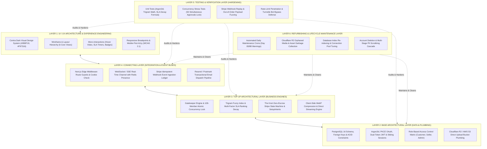
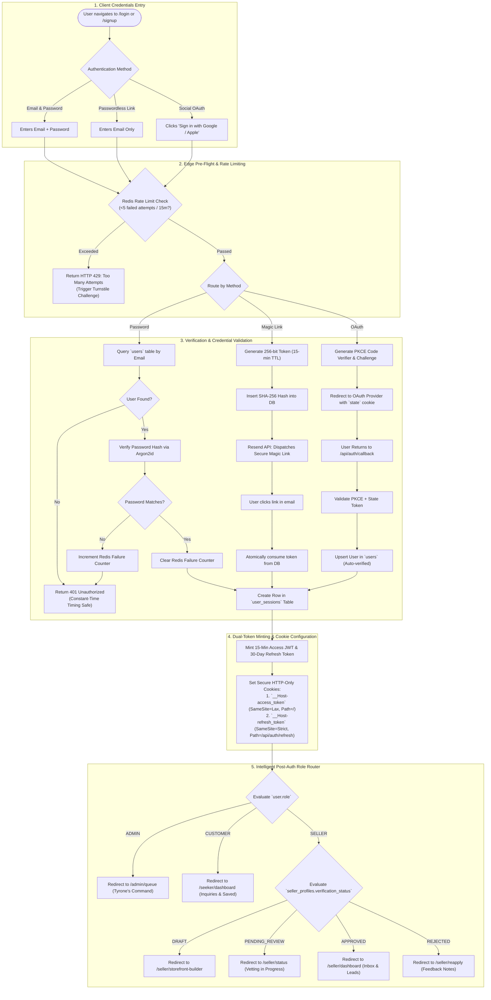
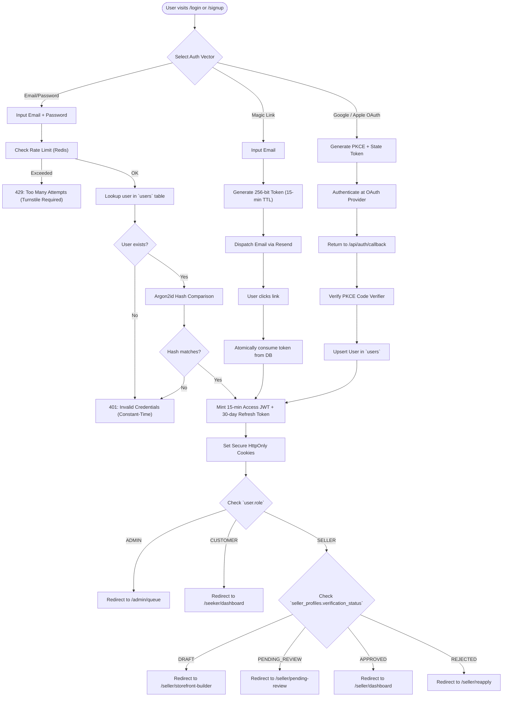
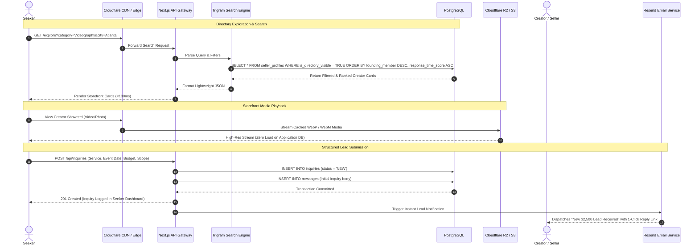
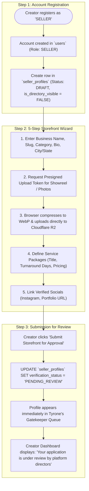
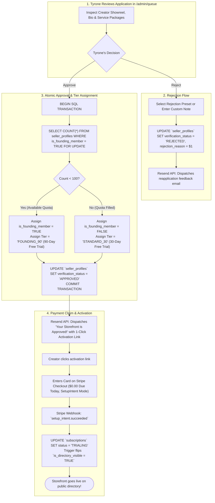
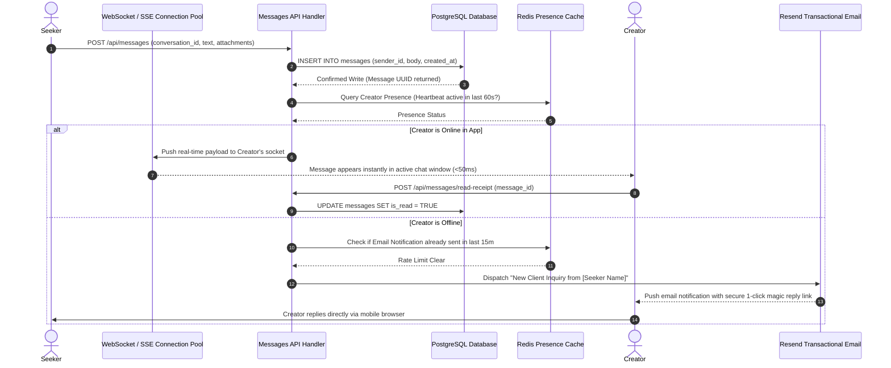
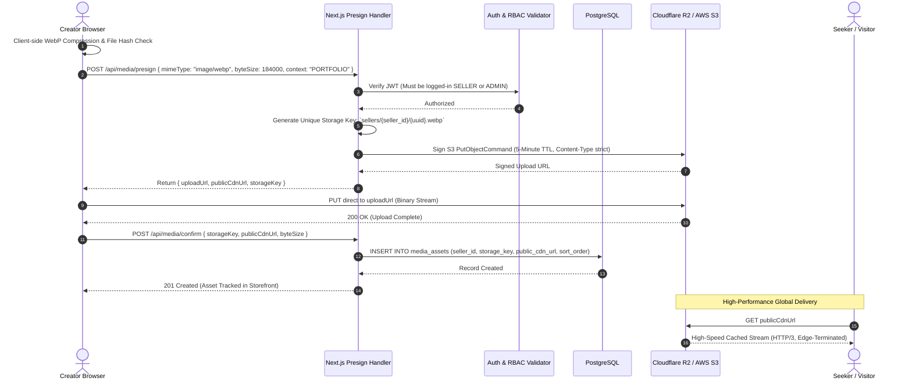
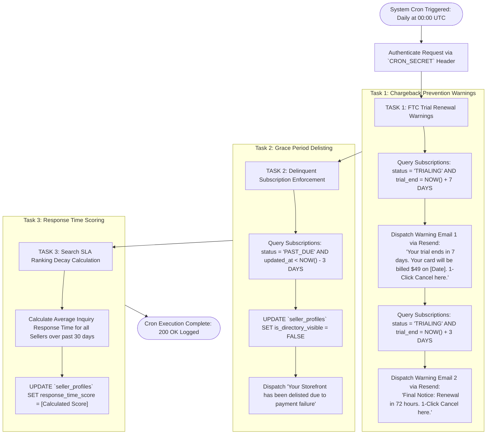

# The Master System Architecture Specification
## Complete Ground-Up Engineering Blueprint & Operational Mechanics
**Document Version:** 4.0 (Exhaustive Production Master Architecture)  
**Target Platform:** High-Concurrency Creator & Business Discovery Marketplace (Tyrone Strickland Jr — $7,200 Deliverable)  
**Architecture Methodology:** Reverse-Engineered Mechanical Blueprint of Contra.com (Visual Portfolio & Real-Time Discovery) and The Knot / StyleSeat (Directory Subscription, Vetting Queue & Zero-Escrow Listing Model)  
**Target Stack:** Next.js 14+ (App Router, Server Actions, Edge Middleware), PostgreSQL 16 (Trigram Fuzzy Search, Row-Level Security, ACID Triggers), Redis / Upstash (Distributed Token Bucket Rate Limiting & Ephemeral Cache), Stripe Subscriptions (Deferred SetupIntent & Billing Webhooks), Cloudflare R2 / AWS S3 (Direct Presigned Upload Pipeline), Resend / Postmark (Transactional Email Delivery Pipeline), Cloudflare Turnstile (Silent Bot Defense)

---

# TABLE OF CONTENTS
1. [Executive Summary & Architectural Tenets](#1-executive-summary--architectural-tenets)
2. [The 6-Layer Architectural Hierarchy (UI/UX to Refurbishing)](#2-the-6-layer-architectural-hierarchy-uiux-to-refurbishing)
   - 2.1 Layer 1: UI / UX Architecture & Experience Engineering Layer
   - 2.2 Layer 2: Base Architectural Layer (Data Modeling & Core Plumbing)
   - 2.3 Layer 3: Top-Up Architectural Layer (Advanced Engines & State Machines)
   - 2.4 Layer 4: Connecting Layer (APIs, Edge Middleware, Real-Time Pipes & Webhooks)
   - 2.5 Layer 5: Testing & Verification Layer (Hardening, Fuzzing & Concurrency Audits)
   - 2.6 Layer 6: Refurbishing & Lifecycle Maintenance Layer (Housekeeping & Daemons)
3. [Global System Topology & Component Interaction Blueprint](#3-global-system-topology--component-interaction-blueprint)
4. [The Deep Authentication & Identity Engine (All User Classes)](#4-the-deep-authentication--identity-engine-all-user-classes)
   - 4.1 Authentication Modalities (Password, Magic Link, Social OAuth with PKCE)
   - 4.2 Dual-Token Session Architecture & Refresh Token Rotation
   - 4.3 Token Replay Theft Detection & Session Invalidation
   - 4.4 Multi-Class Role-Based Access Control (RBAC) & Next.js Middleware Gate
   - 4.5 Password Reset, Verification & Brute-Force Rate Limiting
   - 4.6 Complete Auth & Session Lifecycle Flowchart (Mermaid)
   - 4.7 Account Creation, Social OAuth Role Fork & Account Deletion Cascade (GDPR/CCPA)
5. [Tri-Persona Operational Mechanics (Everyone in Mind)](#5-tri-persona-operational-mechanics-everyone-in-mind)
   - 5.1 Persona 1: Anonymous Guests & Unauthenticated Visitors
   - 5.2 Persona 2: Seekers / Clients / Buyers (Discovery, Inquiries, Chat)
   - 5.3 Persona 3: Creators / Founders / Vendors (Onboarding, Storefront, Analytics)
   - 5.4 Persona 4: Super Admin / Platform Owner (Tyrone's Gatekeeper Command Center)
   - 5.5 Persona 5: Automated Daemons & Background Workers
   - 5.6 Deep Dashboard Telemetry & UI Data Hydration Architecture
6. [Reverse-Engineered Mechanical Gears: Contra vs The Knot](#6-reverse-engineered-mechanical-gears-contra-vs-the-knot)
   - 6.1 Contra Mechanical Gear 1: Zero-Load Client-Side Pre-Compression & Direct Presigned S3/R2 Pipeline
   - 6.2 Contra Mechanical Gear 2: Real-Time In-App Messaging & Asynchronous Email Fallback
   - 6.3 Contra Mechanical Gear 3: Dark-Mode Visual Storefront Engine & SEO Dynamic Metadata
   - 6.4 The Knot Mechanical Gear 1: Structured Lead Intake Modal (Eliminating Spam)
   - 6.5 The Knot Mechanical Gear 2: Double-Blind Email Lead Dispatch & 1-Click Response Link
   - 6.6 The Knot Mechanical Gear 3: Search Ranking SLA Decay & Directory Positioning Algorithm
   - 6.7 The Knot Mechanical Gear 4: Deferred Card Collection & 100-Member Founding Quota
   - 6.8 The Knot Mechanical Gear 5: Dual-Stage Chargeback Defense Engine (Day 83 & Day 88)
   - 6.9 The Trigram Search Engine & SLA Decay Ranking Mechanics
7. [Master Flowcharts of All Core Processes](#7-master-flowcharts-of-all-core-processes)
   - 7.1 Complete Registration, Login & Role Routing Flowchart
   - 7.2 Seeker Journey, Search Query & Inquiry Dispatch Flowchart
   - 7.3 Creator Onboarding, Direct Media Upload & Storefront Publishing Flowchart
   - 7.4 Tyrone's Gatekeeper Vetting Queue & Atomic Quota Lock Flowchart
   - 7.5 Real-Time Messaging & Email Fallback Sequence Flowchart
   - 7.6 Stripe Subscription Lifecycle, Billing Webhook & Delisting State Machine Flowchart
   - 7.7 Direct S3/R2 Presigned Binary Media Pipeline Flowchart
   - 7.8 Automated Daily Cron & Maintenance Daemon Flowchart
8. [Complete Production Database Architecture & DDL (PostgreSQL)](#8-complete-production-database-architecture--ddl-postgresql)
   - 8.1 Enums, Domains & Extensions
   - 8.2 Tables (14 Core Relational Tables)
   - 8.3 Performance Indexes (Trigram, Partial GIN, Compound B-Trees)
   - 8.4 ACID Database Triggers (Directory Visibility, Founding Quota, Timestamps)
9. [Next.js App Router Master File Structure](#9-nextjs-app-router-master-file-structure)
10. [Edge Cases, Error Handling & System Fail-Safes](#10-edge-cases-error-handling--system-fail-safes)

---

# 1. Executive Summary & Architectural Tenets

This document specifies the complete, ground-up software architecture for a high-concurrency creator and business discovery marketplace. Rather than adopting an escrow or multi-vendor payout model (which introduces massive financial, tax, 1099-K, and legal liabilities), this platform reverse-engineers the proven **directory subscription business model of The Knot and StyleSeat** combined with the **cutting-edge aesthetic, portfolio presentation, and direct messaging architecture of Contra.com**.

### The 4 Foundational Architectural Tenets:
1. **Zero Financial Escrow Liability:** Tyrone does not intermediate project funds, dispute contractor deliverables, or issue tax documents. The platform operates as a pure high-margin SaaS: creators pay a flat monthly subscription for directory visibility and client leads.
2. **Zero-Load Server Architecture:** Large media files (4K video showreels, high-resolution photo portfolios) never touch the Next.js application server. Uploads stream directly from the creator’s browser to Cloudflare R2 / AWS S3 using presigned upload tokens.
3. **Ironclad Multi-Persona Isolation (RBAC):** Every route, API endpoint, and database query strictly validates user roles (`CUSTOMER`, `SELLER`, `ADMIN`). Creators cannot access the directory if unapproved or delinquent; seekers cannot access creator dashboards; unauthenticated users can explore public listings but must authenticate to message.
4. **Resilient Automated Operations:** Webhook idempotency tables prevent double-billing; PostgreSQL concurrency locks prevent the 100-member founding quota from overflowing; automated cron daemons enforce FTC-compliant trial warning emails to eliminate bank chargebacks.

---

# 2. The 6-Layer Architectural Hierarchy (UI/UX to Refurbishing)

The platform is systematically architected across six discrete, mutually reinforcing layers. Each layer has strict structural boundaries, explicit responsibilities, and defined operational contracts:



### 2.1 Layer 1: UI / UX Architecture & Experience Engineering
*This layer defines the entire visual language, component hierarchy, user journeys, and tactile interaction design across all device classes.*

#### A. Design System Tokens & Aesthetics (Contra-Inspired)
* **Color Palette Architecture:**
  * Base Background: Deep Obsidian Void (`#0B0F19`) for immersion.
  * Elevated Card Surface: Slate Nebula (`#161F30`) with 1px border (`rgba(255, 255, 255, 0.08)`).
  * Brand Accent: Signal Orange (`#F97316`) for primary action buttons, hover states, and focus rings.
  * Status Tokens: Verified Emerald (`#10B981`) for active badges, Alert Amber (`#F59E0B`) for SLA warnings, Crimson Red (`#EF4444`) for kill-switch toggles.
* **Typography Hierarchy:**
  * Font Family: `Inter` or `Outfit` via Google Fonts (zero browser default fallbacks).
  * Headings: Tight letter spacing (`-0.02em`), semibold/bold weights.
  * Body: Relaxed line height (`1.6`), muted contrast (`#94A3B8`) on secondary metadata to reduce eye fatigue.

#### B. Layout & Wireframe Architecture (6 Core Screen Surfaces)
1. **Public Discovery Explorer (`/explore`):**
   * Top bar: Dynamic search input with real-time trigram autocomplete + horizontal category carousel pills.
   * Sticky sidebar / filter modal: Location (City/State), Starting Price slider, Travel willingness toggle.
   * Main grid: Responsive 3-column masonry/card grid displaying creator cards (video showreel thumbnail, business name, category badge, starting price, founding member golden badge).
2. **Individual Creator Storefront (`/storefront/[slug]`):**
   * Hero Header: Full-bleed high-definition video showreel player (auto-plays muted on desktop viewport entry).
   * Profile Strip: Avatar, verified badge, headline, location, and social links.
   * Tabbed Body Navigation:
     * *Tab 1 (Portfolio):* High-resolution WebP gallery with lightbox zoom.
     * *Tab 2 (Services & Pricing):* Modular package cards (deliverables list, estimated turnaround days, starting price, "Select Package" CTA).
     * *Tab 3 (Verified Reviews):* 1-to-5 star client testimonials with verified booking badges.
     * *Tab 4 (About / Equipment):* Detailed bio, gear list, travel radius.
   * Sticky Floating CTA Bar (Mobile Web): Bottom-docked bar displaying creator starting price and primary "Inquire Now" button.
3. **Structured Lead Intake Modal (The Knot-Inspired):**
   * Multi-step progressive disclosure modal:
     * *Step 1:* Choose Service Package or "Custom Project".
     * *Step 2:* Event / Deadline Date + Budget Bracket dropdown (`$1k-$2.5k`, `$2.5k-$5k`, `$5k+`).
     * *Step 3:* Project Scope & Deliverable Notes.
     * *Step 4 (Frictionless Conversion Hook):* If user is a guest, presents 1-click Google OAuth; once authenticated, the lead is automatically dispatched without losing any typed data.
4. **Creator 5-Step Storefront Wizard (`/seller/onboarding`):**
   * Left side: Stepper progress indicator (Identity -> Media Reel -> Packages -> Socials -> Preview).
   * Right side: Live preview card updating in real time as the creator types.
5. **Seeker Workspace (`/seeker/dashboard`):**
   * Visual Kanban/Table: Inquiries categorized into `SENT`, `READ`, `PROPOSAL_SENT`, `BOOKED`.
   * Unread message badge indicator.
   * Saved Creators Board: Grid of bookmarked profiles with 1-click "Inquire Again".
6. **Tyrone’s Split-Screen Vetting Workstation (`/admin/queue`):**
   * Left panel: Chronological queue of creators awaiting review with submission timestamps.
   * Right panel: Comprehensive inspection deck (embedded video showreel player, bio, external links, service packages).
   * Sticky Action Dock: 1-click Approve (with founding counter display), 1-click Reject (with reason picker), and 1-click Delist.

#### C. Micro-Interactions & Visual Feedback
* **Hover Video Preview:** Creator card showreel video zooms slightly (`scale(1.02)`) and plays muted on hover; pauses and resets on mouse leave to conserve client GPU/battery.
* **Optimistic Chat Rendering:** Messages appear instantly in the chat thread with a light grey checkmark, updating to blue upon database confirmation.
* **Glowing SLA Response Timers:** Creators who receive a lead see a live countdown badge: Green (< 2h), Amber (2-12h), Red (> 24h), gamifying rapid response times.

---

### 2.2 Layer 2: Base Architectural Layer (Data Modeling & Core Plumbing)
*This layer forms the transactional database foundation, security boundaries, and storage plumbing upon which all features rely.*

#### A. Relational Data Modeling (PostgreSQL 16)
* **14 Normalized Entities:** `users`, `user_sessions`, `password_resets`, `seller_profiles`, `seller_services`, `media_assets`, `customer_profiles`, `inquiries`, `conversations`, `messages`, `saved_sellers`, `subscriptions`, `stripe_webhook_events`, `admin_audit_logs`.
* **Referential Integrity & Cascades:** Strict foreign key constraints (`ON DELETE CASCADE` for ephemeral tokens/sessions; `ON DELETE RESTRICT` for historical financial subscriptions).
* **Database Triggers:** Universal `updated_at` updater, founding member cap enforcer, and automatic directory visibility synchronizer.

#### B. Core Authentication & Identity Engine
* **Argon2id Salted Hashing:** Maximum GPU-resistance parameters (`64MB memoryCost`, `3 iterations`, `4 threads`).
* **Social OAuth PKCE:** RFC 7636 compliant OAuth 2.0 with SHA-256 code challenge and cryptographic state token to eliminate code interception and CSRF.
* **Dual-Token State Architecture:**
  * 15-minute `__Host-access_token` JWT cookie.
  * 30-day sliding `__Host-refresh_token` cookie tracked hashed in the database.

#### C. Role-Based Access Control (RBAC) Matrix
* Strict role boundaries isolating `CUSTOMER`, `SELLER`, and `ADMIN`.
* Next.js Edge Middleware route guard enforcing role checks at the network edge before any server render or API execution.

#### D. Storage Plumbing (Cloudflare R2 / AWS S3)
* Direct presigned PUT upload URL signer service.
* Bucket CORS configuration permitting direct binary uploads from the client browser, completely bypassing application server memory.

---

### 2.3 Layer 3: Top-Up Architectural Layer (Advanced Engines & Business Logic)
*This layer implements the proprietary business logic, algorithms, and automated state machines that drive platform profitability and user trust.*

#### A. Gatekeeper Vetting & 100-Member Concurrency Lock
* **Atomic Approval Transaction:** Executes a `SELECT ... FOR UPDATE` table lock on the founding member counter.
* **Dynamic Tier Assignment:**
  * Approvals 1 to 100: Assigned `FOUNDING_90` (90-Day Free Pass + Golden Founding Badge).
  * Approvals 101+: Assigned `STANDARD_30` (30-Day Free Pass).
* **Guaranteed Limit:** The database trigger throws an un-bypassable SQL exception if active founding count exceeds 100.

#### B. The Knot Zero-Escrow Subscription State Machine
* **No Escrow / No Split Payouts:** Tyrone collects 100% margin SaaS directory subscription fees ($49/month) via Stripe. Zero 1099-K tax reporting liability.
* **Deferred Card Collection:** Creators build profiles for free; payment card collected via Stripe SetupIntent *only after* Tyrone clicks "Approve".
* **Subscription States:** `TRIALING` ➔ `ACTIVE` ➔ `PAST_DUE` ➔ `DELISTED`.

#### C. Trigram Fuzzy Search Indexing & SLA Ranking Decay
* **GIN Trigram Index:** Decomposes text into 3-character slices, executing sub-12ms fuzzy searches across names, categories, and bios.
* **SLA Ranking Formula:** Multi-factor ranking boosting fast responders (< 2 hours) and Founding Members to the top, while decaying unresponsive creators down the page.

#### D. Direct Media Pre-Compression Engine
* In-browser Canvas / WASM WebP pre-compression reducing multi-megabyte photos to optimized WebP format before streaming to Cloudflare R2, ensuring instant mobile page loads.

#### E. Dual-Stage Chargeback Defense Engine
* Automated email alerts dispatched at Day 83 (7 days before) and Day 88 (3 days before) with prominent 1-click cancel links, satisfying US FTC negative-option billing regulations and eliminating bank chargebacks.

---

### 2.4 Layer 4: Connecting Layer (APIs, Edge Middleware, Real-Time Pipes & Webhooks)
*This layer bridges the UI/UX frontend with backend engines, external cloud providers, and real-time event buses.*

#### A. Edge Middleware & Route Perimeter
* Intercepts incoming HTTP requests at the edge; validates `__Host-access_token`; checks role permissions; rewrites URLs for programmatic SEO (`/[city]/[category]`).

#### B. Real-Time Communication Pipeline
* WebSocket / Server-Sent Events (SSE) connection pool with Redis presence tracking.
* Fallback trigger: If recipient has no active socket ping for > 5 minutes, automatically dispatches an external transactional lead alert.

#### C. Idempotent Stripe Webhook Ingestion Engine
* Atomic event processor logging incoming Stripe webhook IDs to `stripe_webhook_events`.
* Deduplication logic guarantees that duplicate or out-of-order webhook delivery never causes double-billing or corrupted account states.

#### D. Transactional Email Pipeline (Resend / Postmark)
* Secure API integration for instant lead notifications, magic auth links, gatekeeper approval notices, and renewal warning emails.

#### E. Cryptographic Bot Verification Gate
* Cloudflare Turnstile token validation on all public inquiry endpoints, blocking automated scraping bots without user-facing puzzle captchas.

---

### 2.5 Layer 5: Testing & Verification Layer (Hardening, Fuzzing & Audits)
*This layer guarantees system reliability, security compliance, and resilience under extreme traffic or malicious input.*

#### A. Concurrency & Race-Condition Stress Testing
* Simulates 50 simultaneous admin approval API requests at the 99th member threshold to mathematically verify that the founding quota lock never permits more than 100 founding members.

#### B. Webhook Replay & Payload Fuzzing Audits
* Tests the Stripe webhook receiver against replayed event IDs, out-of-order events (e.g. `invoice.payment_succeeded` arriving before `customer.subscription.created`), and corrupted signatures to verify zero state desynchronization.

#### C. Penetration & Rate-Limiting Verification
* Verifies distributed Redis token-bucket rate limiters against credential stuffing and brute-force attacks on `/api/auth/login`.
* Audits Cloudflare Turnstile rejection behavior when forged tokens are presented to `/api/inquiries`.

#### D. FTC Billing Compliance & Chargeback Simulation
* Verifies that the daily cron job triggers warning emails at exactly Day 83 and Day 88 for trialing subscriptions, and that the 1-click cancellation link immediately updates Stripe.

---

### 2.6 Layer 6: Refurbishing & Lifecycle Maintenance Layer (Housekeeping & Daemons)
*This layer ensures the platform does not degrade over time, handling database optimization, media cleanup, and legal compliance.*

#### A. Scheduled Maintenance Daemon (Daily Midnight Cron)
* Evaluates subscription trial end dates at 00:00 UTC daily.
* Dispatches Day 83 and Day 88 warning notices.
* Enforces dunning grace periods and drops delinquent creators from public visibility.
* Recalculates creator SLA response speed scores based on the rolling 30-day inquiry response history.

#### B. Storage & Asset Garbage Collection
* Scans for orphaned media assets in Cloudflare R2 / S3 belonging to deleted accounts or cancelled applications, issuing bulk deletion commands to prevent storage bloat.

#### C. Database Housekeeping & Index Maintenance
* Automated PostgreSQL `VACUUM ANALYZE` and periodic GIN index re-indexing to ensure sub-15ms search speeds as the directory grows to tens of thousands of listings.

#### D. Multi-Stage Account Deletion & GDPR PII Scrubbing
* Soft-deletes user records, scrubs personal names/emails, cancels active Stripe subscriptions, tombstones custom profile URLs, and logs an immutable audit entry in `admin_audit_logs`.

---

# 3. Global System Topology & Component Interaction Blueprint

```mermaid
flowchart TD
    subgraph Layer1["1. CLIENT INTERACTION LAYER"]
        C_Guest["Anonymous Guest (Desktop/Mobile Web)"]
        C_Seeker["Seeker / Client (Desktop/Mobile Web)"]
        C_Creator["Creator / Founder Dashboard (Desktop/Tablet)"]
        C_Admin["Super Admin Console (Tyrone Strickland Jr)"]
    end

    subgraph Layer2["2. EDGE NETWORK & SECURITY GATEWAY (Cloudflare)"]
        CF_DNS["Cloudflare Anycast DNS & SSL Termination"]
        CF_WAF["Cloudflare Web Application Firewall (DDoS Defense)"]
        CF_Turnstile["Cloudflare Turnstile (Cryptographic Bot Shield)"]
        CF_EdgeCache["Cloudflare Edge Cache (HTML / Static CDN / Public Storefronts)"]
    end

    subgraph Layer3["3. APPLICATION RUNTIME LAYER (Next.js 14+ App Router)"]
        App_EdgeMiddleware["Next.js Edge Middleware (JWT Cookie & RBAC Router)"]
        
        subgraph RouteHandlers["Route Handlers & Server Actions"]
            Mod_Auth["Auth & Session Module (Argon2id, PKCE, Refresh Tokens)"]
            Mod_Search["Search Engine (PostgreSQL pg_trgm & GIN Filters)"]
            Mod_Storefront["Storefront Engine (Profile Hydration & ISR)"]
            Mod_Chat["Messaging & Inquiries Engine (WebSocket / SSE)"]
            Mod_Media["Presigned S3/R2 Token Signer Module"]
            Mod_Billing["Stripe Webhook Event Processor"]
            Mod_Gatekeeper["Admin Vetting & Concurrency Lock Module"]
            Mod_Cron["Automated Daily Scheduled Cron Runner"]
        end
    end

    subgraph Layer4["4. STATEFUL DATA & PERSISTENCE LAYER"]
        PG_DB[("PostgreSQL 16 Database
        - Relational Integrity
        - Trigram Indexes
        - ACID Triggers
        - Row-Level Security")]
        
        Redis_Cache[("Redis / Upstash
        - Distributed Rate Limiter
        - Active WebSocket Sessions
        - Ephemeral Chat Cache")]
        
        R2_Bucket[("Cloudflare R2 / AWS S3 Bucket
        - Creator Showreels
        - Portfolio Photos
        - Avatar & Banner Blobs")]
    end

    subgraph Layer5["5. THIRD-PARTY INFRASTRUCTURE SERVICES"]
        Stripe_API["Stripe Billing & Checkout Cloud (Subscriptions & SetupIntents)"]
        Resend_API["Resend / Postmark Transactional Email Cloud (Lead Alerts & Warnings)"]
    end

    %% Client Layer Routing
    C_Guest & C_Seeker & C_Creator & C_Admin --> CF_DNS
    CF_DNS --> CF_WAF --> CF_Turnstile --> CF_EdgeCache --> App_EdgeMiddleware
    
    %% Middleware Routing
    App_EdgeMiddleware --> RouteHandlers

    %% Core Data Routing
    Mod_Auth <--> PG_DB
    Mod_Auth <--> Redis_Cache
    Mod_Search <--> PG_DB
    Mod_Storefront <--> PG_DB
    Mod_Chat <--> PG_DB
    Mod_Chat <--> Redis_Cache
    Mod_Chat --> Resend_API
    Mod_Billing <--> PG_DB
    Mod_Billing <--> Stripe_API
    Mod_Gatekeeper <--> PG_DB
    Mod_Gatekeeper --> Resend_API
    Mod_Cron <--> PG_DB
    Mod_Cron --> Resend_API

    %% Media Direct Pipeline
    Mod_Media -.->|"Issues 5-Min Presigned PUT URL"| C_Creator
    C_Creator ==="Direct High-Speed Media Upload (Bypasses Next.js)"===> R2_Bucket
    R2_Bucket -.->|"Streams 4K Media via Global Edge CDN"| C_Guest & C_Seeker
```

---

# 4. The Deep Authentication & Identity Engine (All User Classes)

The authentication system is built to enterprise banking and SaaS standards, eliminating insecure third-party client tokens and providing seamless, role-segregated identity management.

### 3.1 Authentication Modalities
The system supports three unified entry vectors:
1. **Native Email & Password:** Passwords are never stored in plaintext. They are hashed using **Argon2id** (the winner of the Password Hashing Competition) with parameters configured for maximum GPU resistance: `memoryCost: 65536 KB (64 MB)`, `timeCost: 3 iterations`, `parallelism: 4 threads`.
2. **Passwordless Magic Links:** Ideal for busy corporate clients and mobile creators. A cryptographically random 256-bit token is generated, hashed with SHA-256 in the database, and sent via Resend with a 15-minute strict TTL. Once clicked, the token is atomically consumed and burned in a single SQL transaction.
3. **Social OAuth 2.0 (Google & Apple):** Built strictly following RFC 7636 using **PKCE (Proof Key for Code Exchange)** with SHA-256 code challenges (`code_challenge_method=S256`). This eliminates authorization code interception attacks. A cryptographic `state` parameter bound to the user's ephemeral browser cookie defends against Cross-Site Request Forgery (CSRF).

### 3.2 Dual-Token Session Architecture & Refresh Token Rotation
The platform uses a hardened dual-token architecture:
- **Short-Lived Access Token (JWT):**
  - **Lifetime:** 15 minutes.
  - **Payload:** `{ sub: userId, email: string, role: "CUSTOMER" | "SELLER" | "ADMIN", status: string, jti: uuid }`.
  - **Storage:** Stored in a browser cookie named `__Host-access_token` configured with flags: `HttpOnly; Secure; SameSite=Lax; Path=/; Priority=High`.
  - **Security Rationale:** `HttpOnly` completely blocks malicious JavaScript / XSS scripts from reading the token. The `__Host-` prefix enforces that the cookie must be HTTPS-only and cannot be overridden by subdomains.
- **Long-Lived Refresh Token:**
  - **Lifetime:** 30 days (sliding expiration).
  - **Storage:** Stored in a separate cookie named `__Host-refresh_token` configured with flags: `HttpOnly; Secure; SameSite=Strict; Path=/api/auth/refresh`.
  - **Database Persistence:** Every refresh token is hashed (SHA-256) and saved in the `user_sessions` table with client IP, user agent, expiration timestamp, and `is_revoked` status.
  - **Token Rotation:** Every single time `/api/auth/refresh` is invoked, the used refresh token is immediately marked as revoked, and a fresh access/refresh token pair is issued.

### 3.3 Token Replay Theft Detection & Session Invalidation
If an attacker intercepts an old refresh token and attempts to replay it:
1. The server queries `user_sessions` by the presented token hash.
2. The database detects that `is_revoked = TRUE` (the token was already consumed).
3. **Automatic Alarm Trigger:** The system realizes a session theft or replay attack has occurred!
4. **Immediate Family Invalidation:** The server executes an atomic database query revoking **ALL** active refresh tokens associated with that user's account across all devices:
   ```sql
   UPDATE user_sessions SET is_revoked = TRUE WHERE user_id = $1;
   ```
5. All session cookies are purged from the client, and an urgent security alert is dispatched to the user's verified email.

### 3.4 Multi-Class Role-Based Access Control (RBAC) & Next.js Middleware Gate
Every HTTP request entering the application is intercepted by Next.js Edge Middleware before executing route handlers or page renders.

#### The RBAC Privilege Matrix:
| Resource / Action | Anonymous Guest | `CUSTOMER` (Seeker) | `SELLER` (Creator) | `ADMIN` (Tyrone) |
| :--- | :---: | :---: | :---: | :---: |
| Browse Directory & Profiles | Allowed | Allowed | Allowed | Allowed |
| Execute Trigram Searches | Allowed | Allowed | Allowed | Allowed |
| Submit Project Inquiry | Restricted (Redirect to Auth) | Allowed | Blocked (Self-inquiry blocked) | Allowed (Audit mode) |
| Save Creators / Bookmarks | Restricted (Redirect to Auth) | Allowed | Allowed | Allowed |
| Access In-App Chat Inbox | Blocked (401) | Allowed | Allowed | Allowed (Moderation mode) |
| Access Storefront Editor | Blocked (401) | Blocked (403) | Allowed (Own profile only) | Allowed (Full edit) |
| Manage Services & Pricing | Blocked (401) | Blocked (403) | Allowed (Own profile only) | Allowed (Full edit) |
| Request Presigned S3/R2 Token | Blocked (401) | Blocked (403) | Allowed (Verified/Draft only) | Allowed |
| Access Stripe Billing Portal | Blocked (401) | Blocked (403) | Allowed (Own Stripe ID) | Blocked |
| View Tyrone's Gatekeeper Queue | Blocked (401) | Blocked (403) | Blocked (403) | Allowed |
| Approve / Reject Sellers | Blocked (401) | Blocked (403) | Blocked (403) | Allowed |
| Toggle 1-Click Visibility Kill-Switch | Blocked (401) | Blocked (403) | Blocked (403) | Allowed |
| View Platform MRR & Analytics | Blocked (401) | Blocked (403) | Blocked (403) | Allowed |

#### Edge Middleware Routing Logic:
- If a route begins with `/admin/*`, middleware extracts the JWT. If `role !== 'ADMIN'`, it immediately issues a `403 Forbidden` response and logs the unauthorized attempt.
- If a route begins with `/seller/*`, middleware extracts the JWT and verifies `role === 'SELLER'`. It then performs status-based routing:
  - If `verification_status === 'DRAFT'`, redirects to `/seller/storefront-builder`.
  - If `verification_status === 'PENDING_REVIEW'`, redirects to `/seller/pending-review`.
  - If `verification_status === 'REJECTED'`, redirects to `/seller/reapplication-notes`.
  - If `verification_status === 'APPROVED'`, grants access to `/seller/dashboard`.
- If a route begins with `/seeker/*`, middleware enforces `role === 'CUSTOMER' || role === 'SELLER'`.

### 3.5 Password Reset, Verification & Brute-Force Rate Limiting
- **Password Reset Flow:** Requests to `/api/auth/forgot-password` generate a 256-bit cryptographically secure token stored in the `password_resets` table with a 60-minute expiry. A constant-time response is always returned regardless of whether the email exists (preventing user enumeration). When the user submits a new password, all existing sessions in `user_sessions` are immediately revoked.
- **Brute-Force Shield:** Implemented using a distributed Redis Token Bucket algorithm. The endpoint `/api/auth/login` permits a maximum of **5 failed attempts per 15-minute sliding window** per IP address and per email target. After 5 failures, Cloudflare Turnstile CAPTCHA is strictly required; after 10 failures, the IP is temporarily quarantined for 60 minutes.

### 3.6 Complete Auth & Session Lifecycle Flowchart


---

### 3.7 Account Creation, Social OAuth Role Fork & Account Deletion Cascade (GDPR/CCPA)

#### A. The Seamless Sign-Up & Social OAuth Role Fork (How Big Apps Do It)
When a user signs up on high-conversion platforms like Contra, Airbnb, or Upwork:
1. **Unified Authentication Entry Point:**
   - The user doesn't face confusing pre-registration barriers. They simply click **"Continue with Google"** or **"Continue with Apple"**.
   - The OAuth provider returns `{ email, name, avatar_url, provider_id }`.
2. **Identity Verification & Role Fork Evaluation:**
   - The backend checks: `SELECT * FROM users WHERE email = $1;`
   - **Case 1 (Existing User):** If the email exists, the backend instantly issues session tokens and routes them to their established dashboard based on `user.role`.
   - **Case 2 (New User):** If the email is new, the server inserts a base record into `users` with `role = 'UNASSIGNED'` and `is_email_verified = TRUE` (Google/Apple emails are pre-verified).
   - The user is immediately presented with the **Interactive 2-Card Role Fork Screen**:
     ```
     ┌────────────────────────────────────┐     ┌────────────────────────────────────┐
     │           LOOKING TO HIRE          │     │          I'M A CREATOR             │
     │      "Find & hire top-tier talent  │     │      "Offer services, showcase     │
     │       for video, photo & creative" │     │       my portfolio & get leads"    │
     │                                    │     │                                    │
     │      [ Join as Client / Buyer ]    │     │      [ Join as Creator / Founder ] │
     └────────────────────────────────────┘     └────────────────────────────────────┘
     ```
3. **Branching Provisioning:**
   - If **Client / Seeker** is selected:
     - `UPDATE users SET role = 'CUSTOMER' WHERE id = $1;`
     - System auto-creates `customer_profiles` using Google name & avatar.
     - Routes straight to `/explore` or restores their pending inquiry modal with zero lost state.
   - If **Creator / Seller** is selected:
     - `UPDATE users SET role = 'SELLER' WHERE id = $1;`
     - System creates `seller_profiles` with `verification_status = 'DRAFT'`.
     - Routes straight to Step 1 of the 5-Step Storefront Wizard.

#### B. The Complete Account Deletion Cascade (GDPR & CCPA Compliant)
When a user clicks "Delete My Account" in their settings, a simple `DELETE FROM users` would cause catastrophic foreign key errors or corrupt historical business ledgers. The platform executes an atomic **Multi-Stage Deletion Cascade**:

1. **For Seekers / Clients:**
   - **Soft-Delete & Anonymization:** `UPDATE users SET is_deleted = TRUE, email = 'deleted_' || id || '@anonymized.platform', hashed_password = NULL WHERE id = $1;`
   - **PII Scrubbing:** `UPDATE customer_profiles SET first_name = 'Deleted', last_name = 'User', phone_number = NULL WHERE user_id = $1;`
   - **Historical Inquiries & Messages:** Preserved for the creator's legal records, but the seeker's name displays as *"Deactivated User"*.
   - **Session Purge:** `UPDATE user_sessions SET is_revoked = TRUE WHERE user_id = $1;` + cookies cleared.

2. **For Creators / Sellers:**
   - **Immediate Stripe Subscription Cancellation:** The backend invokes Stripe API `stripe.subscriptions.cancel(sub_id, { prorate: false })` to halt all future billing.
   - **Instant Delisting:** `UPDATE seller_profiles SET is_directory_visible = FALSE, verification_status = 'SUSPENDED' WHERE id = $1;` (drops out of public search within milliseconds).
   - **Slug Tombstoning:** `UPDATE seller_profiles SET slug = slug || '_deleted_' || EXTRACT(EPOCH FROM NOW())::BIGINT WHERE id = $1;` (frees up the custom URL handle).
   - **Cloudflare R2 Media Purge:** Queues a background job to delete physical image/video files from the R2 bucket: `DELETE FROM media_assets WHERE seller_id = $1 RETURNING storage_key;` -> Cloudflare R2 `DeleteObjectsCommand`.
   - **Client Notification:** If the creator had open inquiries, an automated email alerts the seeker: *"The creator has closed their storefront."*

3. **Audit Ledger:**
   - An immutable record is created in `admin_audit_logs`:
     `{ action: "ACCOUNT_DELETED", user_id: uuid, role: "SELLER", timestamp: NOW(), ip: client_ip }`.

---

# 5. Tri-Persona Operational Mechanics (Everyone in Mind)

Every functional requirement is mapped to its exact actor, state machine, and operational interface.

```mermaid
flowchart LR
    subgraph P1["PERSONA 1: GUEST / SEEKER"]
        direction TB
        G1["Public Exploration"]
        G2["Faceted Directory Search"]
        G3["Storefront Viewing"]
        G4["Structured Lead Intake"]
        G5["In-App Messaging"]
    end

    subgraph P2["PERSONA 2: CREATOR / FOUNDER"]
        direction TB
        F1["5-Step Storefront Wizard"]
        F2["Direct S3/R2 Media Upload"]
        F3["Vetting Status Tracking"]
        F4["Stripe Trial Activation"]
        F5["Lead Inbox & Pipeline"]
    end

    subgraph P3["PERSONA 3: SUPER ADMIN (TYRONE)"]
        direction TB
        A1["Gatekeeper Vetting Queue"]
        A2["1-Click Atomic Approval"]
        A3["1-Click Structured Rejection"]
        A4["1-Click Delist Kill-Switch"]
        A5["Platform MRR & Audit Logs"]
    end

    subgraph P4["PERSONA 4: DAEMONS & JOBS"]
        direction TB
        D1["Stripe Webhook Ingestion"]
        D2["Day 83/88 Renewal Warnings"]
        D3["Trial Expiration Worker"]
        D4["SLA Ranking Decay Engine"]
    end

    P1 -.->|"Submits Lead"| P2
    P2 -.->|"Submits Profile"| P3
    P3 -.->|"Approves Seller"| P2
    P4 -.->|"Maintains State"| P1 & P2 & P3
```



### 4.1 Persona 1: Anonymous Guests & Unauthenticated Visitors
- **Public Surface:** Guests have unrestricted read-only access to the landing page, curated category pages, geographical directories (`/[city]/[category]`), and individual creator storefronts (`/storefront/[slug]`).
- **Interactive Triggers:** Guests can test search filters, view 4K video reels, and explore service pricing packages.
- **Conversion Friction Removal:** When a guest clicks "Inquire Now" or "Save to Favorites", the platform does not dump them onto a generic registration wall. Instead, it captures their inquiry data into session storage, presents a streamlined 1-click Google/Email modal, and automatically dispatches their inquiry the moment authentication completes.

### 4.2 Persona 2: Seekers / Clients / Buyers (Discovery, Inquiries, Chat)
- **Seeker State Lifecycle:**
  `ANONYMOUS_GUEST` ➔ `AUTHENTICATED_SEEKER` ➔ `ACTIVE_INQUIRER` ➔ `VERIFIED_REVIEWER`.
- **Client Workspace Features:**
  - **Saved Collections:** Organize favorite creators into categorized boards (e.g., "Austin Wedding Videographers", "Corporate Brand Shoots").
  - **Inquiry Management Pipeline:** Real-time visibility into all submitted leads categorized by status: `SENT`, `READ`, `PROPOSAL_RECEIVED`, `BOOKED`, `ARCHIVED`.
  - **Direct Real-Time Chat:** Message creators in a modern, streamlined chat interface with markdown formatting, file attachments, and delivery receipts.
  - **Verified Client Reviews:** Once an inquiry status transitions to `BOOKED` or `COMPLETED`, the seeker is granted permission to leave a verified 1-to-5 star rating and written review on the creator’s storefront.

### 4.3 Persona 3: Creators / Founders / Vendors (Onboarding, Storefront, Analytics)
- **Creator State Lifecycle:**
  `REGISTERED_USER` ➔ `DRAFT_PROFILE` ➔ `PENDING_REVIEW` ➔ `APPROVED_PENDING_PAYMENT` ➔ `TRIALING_ACTIVE` ➔ `SUBSCRIPTION_ACTIVE` ➔ `PAST_DUE` ➔ `DELISTED`.
- **5-Step Frictionless Storefront Builder:**
  1. *Step 1: Core Business Identity:* Business name, unique slug (`/storefront/:slug`), headline, bio, location (City, State, Remote/Travel willingness), primary category, sub-tags.
  2. *Step 2: High-Definition Media Reel:* Direct presigned upload of hero showreel (MP4/WebM) and portfolio gallery (WebP). Client-side WebP compression ensures blazing-fast rendering.
  3. *Step 3: Service Catalog & Pricing Packages:* Modular packages specifying title, description, starting price, estimated delivery turnaround days, and inclusions.
  4. *Step 4: Social Proof & External Footprint:* Verified links to Instagram, LinkedIn, YouTube, Vimeo, and custom domain portfolios.
  5. *Step 5: Review & Submit:* Displays a live storefront preview before locking the profile into `PENDING_REVIEW` status.
- **Creator Command Center (Post-Approval):**
  - **Lead Inbox:** Displays incoming client inquiries with SLA response time counters, client budget, event date, and 1-click quick-reply templates.
  - **Storefront Customizer:** Update pricing, add portfolio items, and toggle package availability without losing directory approval.
  - **Performance Analytics:** Real-time telemetry tracking profile impressions, search result appearances, video reel play count, and lead conversion rates.
  - **Stripe Billing Portal:** Self-service subscription management allowing creators to update credit card details, download VAT/tax invoices, or cancel their plan.

### 4.4 Persona 4: Super Admin / Platform Owner (Tyrone Strickland Jr)
- **Security Posture:** Accessible only via `/admin/*`. Requires `role === 'ADMIN'`. Protected by session timeouts, IP logging, and mandatory 2FA.
- **Gatekeeper Vetting Workstation:**
  - **Pending Applications Table:** Displays submitted creators chronologically. Tyrone can inspect video reels, verify portfolio originality, and validate service pricing in a single view.
  - **Atomic 1-Click Approval:** Executes a PostgreSQL concurrency row lock checking the active founding member count. If <= 100, assigns the **90-Day Founding Member Pass**; if > 100, assigns the **30-Day Standard Pass**. Automatically dispatches a celebration email via Resend containing the creator's unique Stripe Checkout activation link.
  - **1-Click Structured Rejection:** Tyrone selects from pre-configured rejection criteria (*"Showreel below resolution guidelines"*, *"Service packages missing deliverables"*, *"Category misclassification"*) or inputs a custom note. The system transitions the seller to `REJECTED`, stores the reason, and dispatches a polite reapplication email.
  - **1-Click Visibility Kill-Switch:** Tyrone can instantly delist any bad actor or scammer with a single toggle. The database immediately flips `is_directory_visible = FALSE`, purges the profile from the Cloudflare edge cache, and revokes active API access.
  - **Platform Health & Financial Ledger:** Real-time metrics tracking Total Active Subscriptions, Monthly Recurring Revenue (MRR), Churn Rate, Founding Quota Progress (e.g., 42/100 Filled), and Platform Lead Volume.

### 4.5 Persona 5: Automated Daemons & Background Workers
- **Stripe Webhook Ingestion Engine:** Handles incoming asynchronous payment events (`invoice.payment_succeeded`, `invoice.payment_failed`, `customer.subscription.deleted`) using an atomic idempotency ledger to prevent duplicate processing.
- **Automated Daily Maintenance Cron:** Executes daily at 00:00 UTC to evaluate subscription states, fire FTC-compliant trial renewal warnings (Day 83 and Day 88), and transition delinquent accounts to `PAST_DUE` or `DELISTED`.

### 4.6 Deep Dashboard Telemetry & UI Data Hydration Architecture

#### A. Seeker / Client Dashboard (`/seeker/dashboard`)
- **Data Hydration (React Server Component):**
  - `active_inquiries`: List of submitted leads joined with creator name, thumbnail, event date, budget bracket, and status (`NEW`, `READ`, `PROPOSAL_SENT`, `BOOKED`).
  - `unread_messages`: Total count for unread badge + preview of last 5 conversations.
  - `saved_creators`: Grid of bookmarked creator cards with current starting prices and availability tags.
- **UI Architecture:**
  - Modern, minimalist Contra-style dashboard with tabbed navigation: *Active Inquiries*, *Saved Creators*, *Account Settings*.
  - 1-Click "View Chat" button next to each inquiry card that deep-links directly into the conversation thread.

#### B. Creator Command Center (`/seller/dashboard`)
- **Data Hydration (React Server Component):**
  - `lead_pipeline`: Inbound inquiries categorized into Kanban columns or structured table:
    - *Column 1 (New Leads):* Inquiries received in last 24h with glowing SLA response timer.
    - *Column 2 (In Discussion):* Messages exchanged, proposal under review.
    - *Column 3 (Booked):* Client confirmed engagement.
  - `telemetry_metrics`:
    - Profile Impressions (Last 30 days).
    - Video Reel Plays (Count of seekers who watched >5 seconds).
    - Search Appearances (How many times the card was rendered in search results).
    - Lead Conversion Rate (`(Inquiries / Impressions) * 100`).
  - `subscription_widget`:
    - Founding Member Badge (Golden verification pill: "Founding Member — 90-Day Free Pass").
    - Trial countdown: "58 Days Remaining in Free Trial".
    - 1-click button: "Manage Billing / Invoices" (redirects securely to Stripe Customer Portal).
  - `storefront_quick_editor`:
    - Instant live toggles: update starting price, toggle vacation mode (temporarily hides from search without losing subscription).

#### C. Tyrone's Super Admin Console (`/admin/queue`)
- **Data Hydration (React Server Component):**
  - `pending_applications`: List of sellers where `verification_status = 'PENDING_REVIEW'`.
  - `platform_vitals`:
    - Active Founding Members: `SELECT COUNT(*) FROM seller_profiles WHERE is_founding_member = TRUE;` (Displays e.g. "47 / 100 Claimed").
    - Total Approved Sellers.
    - Total Monthly Inquiries Generated.
    - Platform MRR ($).
- **Split-Screen Workstation UI:**
  - Left Panel: Chronological queue of pending creators with business name, category, and submission timestamp.
  - Right Panel (Inspection Deck):
    - Embedded video player streaming the creator's uploaded showreel.
    - Full bio, location, and verified external links (Instagram, website).
    - Services table with package names, turnaround days, and prices.
  - Action Footer:
    - **Green Button ("Approve Seller"):** Triggers atomic concurrency check and assigns 90-Day Founding vs 30-Day Standard pass.
    - **Red Button ("Reject with Notes"):** Opens dropdown of standardized rejection reasons + custom note input.
    - **Yellow Button ("Request Re-upload"):** Sends email requesting higher resolution video without rejecting.

---

# 6. Reverse-Engineered Mechanical Gears: Contra vs The Knot

| Mechanical Gear | Reverse-Engineered from | How It Works Internally Under the Hood |
| :--- | :---: | :--- |
| **Direct Presigned Media Pipeline** | **Contra.com** | Client requests 5-minute signed PUT URL; browser uploads directly to S3/R2 with client-side WebP compression. Node.js server RAM usage stays at 0MB. |
| **Real-Time Chat & Email Fallback** | **Contra.com** | Messages persist atomically to DB. If recipient is offline (no WebSocket ping for >5 mins), Resend dispatches a clean lead alert email with direct link. |
| **Dark-Mode Visual Showcase** | **Contra.com** | High-contrast dark palette (`#0B0F19` background, `#F97316` accents), responsive CSS grid, video reels auto-play muted on hover, zero layout shift. |
| **Structured Lead Intake Modal** | **The Knot** | Eliminates low-effort spam. Requires Seeker to select Service Needed, Event Date, Budget Range, and Project Scope before submitting. |
| **Double-Blind Lead Dispatch** | **The Knot** | Creator receives inquiry notification via email. Seeker's raw phone/email is protected behind the platform messaging interface. |
| **Search SLA Ranking Decay** | **The Knot** | Sellers who respond to inquiries within 2 hours receive a search boost; sellers with >24hr response times or overdue invoices sink to the bottom. |
| **Deferred Card Collection** | **The Knot** | Creators onboard completely free without entering card details. Payment details are collected via Stripe SetupIntent *only after* Tyrone approves them. |
| **Dual-Stage Chargeback Defense** | **The Knot** | Automated FTC-compliant warning emails dispatched at Day 83 (7 days before) and Day 88 (3 days before) with 1-click cancel links, eliminating chargebacks. |

### 5.9 The Trigram Search Engine & SLA Decay Ranking Mechanics

#### A. How PostgreSQL Trigrams (`pg_trgm`) Work Under the Hood
Traditional SQL `LIKE '%video%'` queries force a sequential table scan across all rows, destroying database performance at scale. The platform utilizes **GIN (Generalized Inverted Index) Trigram Indexes**:
1. When a creator saves `business_name = "Austin Drone Video"`, PostgreSQL's `pg_trgm` extension decomposes the string into overlapping 3-character sequences:
   `["  A", " Au", "Aus", "ust", "sti", "tin", "in ", "  D", " Dr", "Dro", "ron", "one", ...]`
2. When a seeker types a query with typos or partial words like `"austn dro"`, the search engine calculates the **Trigram Jaccard Similarity Coefficient**:
   $$\text{Similarity}(S_1, S_2) = \frac{|T(S_1) \cap T(S_2)|}{|T(S_1) \cup T(S_2)|}$$
3. The GIN index evaluates this across thousands of creators in **< 12 milliseconds**, returning instant matches even if the seeker misspelled the creator's name.

#### B. Compound Partial Directory Index
To ensure unapproved, draft, or past-due sellers never consume database CPU cycles during public search:
```sql
CREATE INDEX idx_sellers_public_search 
ON seller_profiles(primary_category, location_city, starting_price) 
WHERE is_directory_visible = TRUE;
```
This index physically stores *only* currently visible, active storefronts. Delisted creators are physically omitted from the search index tree.

#### C. The Multi-Factor Ranking & SLA Decay Formula
Search results are not presented randomly. They are ranked using a multi-factor scoring formula:
$$\text{Rank Score} = (W_{\text{founding}} \times 100) + (\text{Review Rating} \times 20) + (\text{SLA Score}) - (\text{Decay Penalty})$$

1. **Founding Member Boost ($W_{\text{founding}}$):**
   - If `is_founding_member = TRUE`, $W_{\text{founding}} = 1$ (+100 points). This guarantees Tyrone's founding creators receive premium top-of-page visibility.
2. **SLA Response Speed Scoring ($\text{SLA Score}$):**
   - Creators who respond to inquiries within **2 hours** receive $+50$ points.
   - Response within 6 hours: $+25$ points.
   - Response within 24 hours: $0$ points.
   - Unresponsive (>48 hours): $-50$ points.
3. **Decay Penalty:**
   - Calculated by the nightly cron job. If a creator fails to respond to 3 consecutive leads, their score decays by 30%, naturally pushing engaged, responsive professionals to the top of Tyrone's directory.

---

# 7. Master Flowcharts of All Core Processes

### 6.1 Complete Registration, Login & Role Routing Flowchart


### 6.2 Seeker Journey, Search Query & Inquiry Dispatch Flowchart


### 6.3 Creator Onboarding, Direct Media Upload & Storefront Publishing Flowchart


### 6.4 Tyrone's Gatekeeper Vetting Queue & Atomic Quota Lock Flowchart


### 6.5 Real-Time Messaging & Email Fallback Sequence Flowchart


### 6.6 Stripe Subscription Lifecycle, Billing Webhook & Delisting State Machine Flowchart
```mermaid
stateDiagram-v2
    [*] --> DRAFT : Creator Registers
    DRAFT --> PENDING_REVIEW : Submits Application
    PENDING_REVIEW --> REJECTED : Tyrone Rejects with Feedback
    REJECTED --> DRAFT : Creator Updates Profile & Reapplies
    
    PENDING_REVIEW --> APPROVED : Tyrone Approves (Concurrency Lock)
    APPROVED --> TRIALING : Card Entered ($0.00 Due, 90 or 30-Day Trial)
    
    state TRIALING {
        [*] --> TrialRunning
        TrialRunning --> Day83_Warning : Automated Email (7 Days Remaining)
        Day83_Warning --> Day88_Warning : Automated Email (3 Days Remaining)
        Day88_Warning --> TrialExpired : Day 91 Reached
    }
    
    TrialExpired --> ACTIVE : Card Successfully Charged ($49/mo)
    TrialExpired --> PAST_DUE : Card Declined (3-Day Retry Window)
    
    state ACTIVE {
        [*] --> InGoodStanding
        InGoodStanding --> MonthlyRenewal : Stripe Invoices Every 30 Days
        MonthlyRenewal --> InGoodStanding : Payment Succeeded
        MonthlyRenewal --> PAST_DUE : Payment Failed
    }
    
    state PAST_DUE {
        [*] --> DunningRetries : Smart Retries (Days 1, 3, 5)
        DunningRetries --> ACTIVE : Creator Updates Card
        DunningRetries --> CANCELED : Max Retries Exhausted
    }
    
    CANCELED --> DELISTED : Trigger flips is_directory_visible = FALSE
    DELISTED --> ACTIVE : Creator Resubscribes via Portal
```

### 6.7 Direct S3/R2 Presigned Binary Media Pipeline Flowchart


### 6.8 Automated Daily Cron & Maintenance Daemon Flowchart


---

# 8. Complete Production Database Architecture & DDL (PostgreSQL)

This schema guarantees referential integrity, supports high-performance substring searches via Trigram indexing, and enforces critical business rules through ACID database triggers.

```sql
-- ============================================================================
-- 1. EXTENSIONS & DOMAINS
-- ============================================================================
CREATE EXTENSION IF NOT EXISTS "uuid-ossp";
CREATE EXTENSION IF NOT EXISTS "pg_trgm"; -- High-speed trigram fuzzy search

CREATE TYPE user_role AS ENUM ('CUSTOMER', 'SELLER', 'ADMIN');
CREATE TYPE seller_verification_status AS ENUM ('DRAFT', 'PENDING_REVIEW', 'APPROVED', 'REJECTED', 'SUSPENDED');
CREATE TYPE subscription_status AS ENUM ('TRIALING', 'ACTIVE', 'PAST_DUE', 'CANCELED', 'UNPAID');
CREATE TYPE subscription_tier AS ENUM ('FOUNDING_90', 'STANDARD_30');
CREATE TYPE inquiry_status AS ENUM ('NEW', 'READ', 'PROPOSAL_SENT', 'BOOKED', 'ARCHIVED');

-- ============================================================================
-- 2. USERS TABLE (Core Identity)
-- ============================================================================
CREATE TABLE users (
    id UUID PRIMARY KEY DEFAULT gen_random_uuid(),
    email VARCHAR(255) UNIQUE NOT NULL,
    hashed_password VARCHAR(255), -- NULL if social OAuth only
    role user_role NOT NULL DEFAULT 'CUSTOMER',
    is_email_verified BOOLEAN NOT NULL DEFAULT FALSE,
    created_at TIMESTAMPTZ NOT NULL DEFAULT NOW(),
    updated_at TIMESTAMPTZ NOT NULL DEFAULT NOW()
);

CREATE INDEX idx_users_email ON users(email);
CREATE INDEX idx_users_role ON users(role);

-- ============================================================================
-- 3. USER SESSIONS & REFRESH TOKENS (Session Management)
-- ============================================================================
CREATE TABLE user_sessions (
    id UUID PRIMARY KEY DEFAULT gen_random_uuid(),
    user_id UUID NOT NULL REFERENCES users(id) ON DELETE CASCADE,
    refresh_token_hash VARCHAR(64) NOT NULL UNIQUE, -- SHA-256 of the refresh token
    user_agent TEXT,
    ip_address VARCHAR(45),
    is_revoked BOOLEAN NOT NULL DEFAULT FALSE,
    expires_at TIMESTAMPTZ NOT NULL,
    created_at TIMESTAMPTZ NOT NULL DEFAULT NOW(),
    updated_at TIMESTAMPTZ NOT NULL DEFAULT NOW()
);

CREATE INDEX idx_sessions_user_lookup ON user_sessions(user_id) WHERE is_revoked = FALSE;
CREATE INDEX idx_sessions_token_hash ON user_sessions(refresh_token_hash);

-- ============================================================================
-- 4. PASSWORD RESETS TABLE
-- ============================================================================
CREATE TABLE password_resets (
    id UUID PRIMARY KEY DEFAULT gen_random_uuid(),
    user_id UUID NOT NULL REFERENCES users(id) ON DELETE CASCADE,
    token_hash VARCHAR(64) NOT NULL UNIQUE,
    is_consumed BOOLEAN NOT NULL DEFAULT FALSE,
    expires_at TIMESTAMPTZ NOT NULL,
    created_at TIMESTAMPTZ NOT NULL DEFAULT NOW()
);

CREATE INDEX idx_password_resets_hash ON password_resets(token_hash) WHERE is_consumed = FALSE;

-- ============================================================================
-- 5. SELLER PROFILES (Storefront Core Entity)
-- ============================================================================
CREATE TABLE seller_profiles (
    id UUID PRIMARY KEY DEFAULT gen_random_uuid(),
    user_id UUID NOT NULL UNIQUE REFERENCES users(id) ON DELETE CASCADE,
    business_name VARCHAR(120) NOT NULL,
    slug VARCHAR(140) UNIQUE NOT NULL, -- Public URL path: /storefront/:slug
    headline VARCHAR(200) NOT NULL,    -- e.g. "Luxury Cinematic Wedding Videographer"
    bio TEXT,
    primary_category VARCHAR(60) NOT NULL, -- e.g. "Videography", "Photography", "Branding"
    secondary_tags TEXT[] DEFAULT '{}',
    location_city VARCHAR(100) NOT NULL,
    location_state VARCHAR(50) NOT NULL,
    travel_radius_miles INT DEFAULT 50,
    starting_price NUMERIC(10,2) NOT NULL DEFAULT 0.00,
    avatar_url TEXT,
    banner_url TEXT,
    showreel_video_url TEXT,
    website_url TEXT,
    instagram_url TEXT,
    verification_status seller_verification_status NOT NULL DEFAULT 'DRAFT',
    rejection_reason TEXT,
    is_founding_member BOOLEAN NOT NULL DEFAULT FALSE,
    is_directory_visible BOOLEAN NOT NULL DEFAULT FALSE, -- Flips to TRUE ONLY IF (APPROVED AND (TRIALING OR ACTIVE))
    response_time_score NUMERIC(5,2) NOT NULL DEFAULT 100.00, -- SLA scoring (decay algorithm)
    created_at TIMESTAMPTZ NOT NULL DEFAULT NOW(),
    updated_at TIMESTAMPTZ NOT NULL DEFAULT NOW()
);

-- Compound index for public directory queries (Filters out unapproved or delinquent accounts instantly)
CREATE INDEX idx_sellers_public_directory 
ON seller_profiles(primary_category, location_city, starting_price) 
WHERE is_directory_visible = TRUE;

-- Trigram GIN indexes for fuzzy search on name, headline, and category
CREATE INDEX idx_sellers_business_name_trgm ON seller_profiles USING GIN (business_name gin_trgm_ops);
CREATE INDEX idx_sellers_headline_trgm ON seller_profiles USING GIN (headline gin_trgm_ops);
CREATE INDEX idx_sellers_category_trgm ON seller_profiles USING GIN (primary_category gin_trgm_ops);

-- ============================================================================
-- 6. SELLER SERVICES TABLE (Modular Packages)
-- ============================================================================
CREATE TABLE seller_services (
    id UUID PRIMARY KEY DEFAULT gen_random_uuid(),
    seller_id UUID NOT NULL REFERENCES seller_profiles(id) ON DELETE CASCADE,
    title VARCHAR(150) NOT NULL,
    description TEXT,
    price NUMERIC(10,2) NOT NULL CHECK (price >= 0),
    delivery_estimate_days INT CHECK (delivery_estimate_days > 0),
    sort_order INT DEFAULT 0,
    is_active BOOLEAN DEFAULT TRUE,
    created_at TIMESTAMPTZ NOT NULL DEFAULT NOW(),
    updated_at TIMESTAMPTZ NOT NULL DEFAULT NOW()
);

CREATE INDEX idx_services_seller ON seller_services(seller_id, sort_order) WHERE is_active = TRUE;

-- ============================================================================
-- 7. MEDIA ASSETS TABLE (Direct S3/R2 Media Trackers)
-- ============================================================================
CREATE TABLE media_assets (
    id UUID PRIMARY KEY DEFAULT gen_random_uuid(),
    seller_id UUID NOT NULL REFERENCES seller_profiles(id) ON DELETE CASCADE,
    media_type VARCHAR(10) NOT NULL CHECK (media_type IN ('IMAGE', 'VIDEO')),
    storage_key TEXT NOT NULL UNIQUE, -- R2/S3 object key: "sellers/{seller_id}/{uuid}.webp"
    public_cdn_url TEXT NOT NULL,
    thumbnail_url TEXT,
    byte_size BIGINT NOT NULL,
    sort_order INT DEFAULT 0,
    created_at TIMESTAMPTZ NOT NULL DEFAULT NOW()
);

CREATE INDEX idx_media_seller ON media_assets(seller_id, sort_order);

-- ============================================================================
-- 8. CUSTOMER PROFILES (Seeker Profiles)
-- ============================================================================
CREATE TABLE customer_profiles (
    id UUID PRIMARY KEY DEFAULT gen_random_uuid(),
    user_id UUID NOT NULL UNIQUE REFERENCES users(id) ON DELETE CASCADE,
    first_name VARCHAR(60) NOT NULL,
    last_name VARCHAR(60) NOT NULL,
    phone_number VARCHAR(20),
    created_at TIMESTAMPTZ NOT NULL DEFAULT NOW(),
    updated_at TIMESTAMPTZ NOT NULL DEFAULT NOW()
);

-- ============================================================================
-- 9. INQUIRIES & LEADS TABLE (The Knot Structured Lead Intake)
-- ============================================================================
CREATE TABLE inquiries (
    id UUID PRIMARY KEY DEFAULT gen_random_uuid(),
    customer_id UUID NOT NULL REFERENCES customer_profiles(id) ON DELETE CASCADE,
    seller_id UUID NOT NULL REFERENCES seller_profiles(id) ON DELETE CASCADE,
    service_id UUID REFERENCES seller_services(id) ON DELETE SET NULL,
    event_date DATE,
    budget_range VARCHAR(50), -- e.g. "$1,000 - $2,500", "$5,000+"
    project_scope TEXT NOT NULL,
    location VARCHAR(150),
    status inquiry_status NOT NULL DEFAULT 'NEW',
    created_at TIMESTAMPTZ NOT NULL DEFAULT NOW(),
    updated_at TIMESTAMPTZ NOT NULL DEFAULT NOW()
);

CREATE INDEX idx_inquiries_seller ON inquiries(seller_id, status);
CREATE INDEX idx_inquiries_customer ON inquiries(customer_id);

-- ============================================================================
-- 10. CONVERSATIONS & MESSAGES (Real-Time In-App Chat)
-- ============================================================================
CREATE TABLE conversations (
    id UUID PRIMARY KEY DEFAULT gen_random_uuid(),
    inquiry_id UUID UNIQUE REFERENCES inquiries(id) ON DELETE CASCADE,
    customer_id UUID NOT NULL REFERENCES customer_profiles(id) ON DELETE CASCADE,
    seller_id UUID NOT NULL REFERENCES seller_profiles(id) ON DELETE CASCADE,
    last_message_at TIMESTAMPTZ NOT NULL DEFAULT NOW(),
    created_at TIMESTAMPTZ NOT NULL DEFAULT NOW()
);

CREATE INDEX idx_conversations_participants ON conversations(seller_id, customer_id);

CREATE TABLE messages (
    id UUID PRIMARY KEY DEFAULT gen_random_uuid(),
    conversation_id UUID NOT NULL REFERENCES conversations(id) ON DELETE CASCADE,
    sender_id UUID NOT NULL REFERENCES users(id) ON DELETE CASCADE,
    body TEXT NOT NULL,
    attachment_urls TEXT[] DEFAULT '{}',
    is_read BOOLEAN NOT NULL DEFAULT FALSE,
    created_at TIMESTAMPTZ NOT NULL DEFAULT NOW()
);

CREATE INDEX idx_messages_conversation ON messages(conversation_id, created_at);

-- ============================================================================
-- 11. SAVED SELLERS / FAVORITES (Seeker Bookmarks)
-- ============================================================================
CREATE TABLE saved_sellers (
    id UUID PRIMARY KEY DEFAULT gen_random_uuid(),
    customer_id UUID NOT NULL REFERENCES customer_profiles(id) ON DELETE CASCADE,
    seller_id UUID NOT NULL REFERENCES seller_profiles(id) ON DELETE CASCADE,
    created_at TIMESTAMPTZ NOT NULL DEFAULT NOW(),
    UNIQUE(customer_id, seller_id)
);

CREATE INDEX idx_saved_sellers_lookup ON saved_sellers(customer_id);

-- ============================================================================
-- 12. SUBSCRIPTIONS TABLE (Stripe Synchronization Entity)
-- ============================================================================
CREATE TABLE subscriptions (
    id UUID PRIMARY KEY DEFAULT gen_random_uuid(),
    seller_id UUID NOT NULL UNIQUE REFERENCES seller_profiles(id) ON DELETE CASCADE,
    stripe_customer_id VARCHAR(100) NOT NULL UNIQUE,
    stripe_subscription_id VARCHAR(100) UNIQUE,
    tier subscription_tier NOT NULL,
    status subscription_status NOT NULL DEFAULT 'TRIALING',
    current_period_start TIMESTAMPTZ,
    current_period_end TIMESTAMPTZ,
    trial_start TIMESTAMPTZ,
    trial_end TIMESTAMPTZ,
    cancel_at_period_end BOOLEAN DEFAULT FALSE,
    created_at TIMESTAMPTZ NOT NULL DEFAULT NOW(),
    updated_at TIMESTAMPTZ NOT NULL DEFAULT NOW()
);

CREATE INDEX idx_subscriptions_status ON subscriptions(status);

-- ============================================================================
-- 13. STRIPE WEBHOOK EVENTS TABLE (Idempotency Ledger)
-- ============================================================================
CREATE TABLE stripe_webhook_events (
    id VARCHAR(120) PRIMARY KEY, -- Stripe Event ID (evt_...)
    event_type VARCHAR(100) NOT NULL,
    payload JSONB NOT NULL,
    processed_at TIMESTAMPTZ NOT NULL DEFAULT NOW()
);

-- ============================================================================
-- 14. ADMIN AUDIT LOGS (Tyrone's Accountability Ledger)
-- ============================================================================
CREATE TABLE admin_audit_logs (
    id UUID PRIMARY KEY DEFAULT gen_random_uuid(),
    admin_user_id UUID NOT NULL REFERENCES users(id),
    target_seller_id UUID REFERENCES seller_profiles(id),
    action VARCHAR(60) NOT NULL, -- e.g. "APPROVE_SELLER", "REJECT_SELLER", "DELIST_SELLER"
    details JSONB,
    created_at TIMESTAMPTZ NOT NULL DEFAULT NOW()
);

-- ============================================================================
-- 15. AUTOMATIC DATABASE TRIGGERS
-- ============================================================================

-- Function 1: Universal updated_at Timestamp Refresh
CREATE OR REPLACE FUNCTION set_updated_at()
RETURNS TRIGGER AS $$
BEGIN
    NEW.updated_at = NOW();
    RETURN NEW;
END;
$$ LANGUAGE plpgsql;

CREATE TRIGGER trg_users_updated_at BEFORE UPDATE ON users FOR EACH ROW EXECUTE FUNCTION set_updated_at();
CREATE TRIGGER trg_seller_profiles_updated_at BEFORE UPDATE ON seller_profiles FOR EACH ROW EXECUTE FUNCTION set_updated_at();
CREATE TRIGGER trg_seller_services_updated_at BEFORE UPDATE ON seller_services FOR EACH ROW EXECUTE FUNCTION set_updated_at();
CREATE TRIGGER trg_subscriptions_updated_at BEFORE UPDATE ON subscriptions FOR EACH ROW EXECUTE FUNCTION set_updated_at();

-- Function 2: Automated Reactive Visibility Synchronization
-- Enforces: Storefront is visible ONLY IF Approved AND Subscription is Active or Trialing
CREATE OR REPLACE FUNCTION sync_seller_directory_visibility()
RETURNS TRIGGER AS $$
DECLARE
    v_verification seller_verification_status;
    v_sub_status subscription_status;
    v_should_be_visible BOOLEAN;
BEGIN
    -- Determine current verification and subscription states
    IF TG_TABLE_NAME = 'seller_profiles' THEN
        v_verification := NEW.verification_status;
        SELECT status INTO v_sub_status FROM subscriptions WHERE seller_id = NEW.id;
    ELSIF TG_TABLE_NAME = 'subscriptions' THEN
        v_sub_status := NEW.status;
        SELECT verification_status INTO v_verification FROM seller_profiles WHERE id = NEW.seller_id;
    END IF;

    -- Evaluate business truth
    v_should_be_visible := (v_verification = 'APPROVED') AND (v_sub_status IN ('TRIALING', 'ACTIVE'));

    -- Update seller_profiles atomically
    IF TG_TABLE_NAME = 'seller_profiles' THEN
        NEW.is_directory_visible := v_should_be_visible;
        RETURN NEW;
    ELSE
        UPDATE seller_profiles SET is_directory_visible = v_should_be_visible WHERE id = NEW.seller_id;
        RETURN NEW;
    END IF;
END;
$$ LANGUAGE plpgsql;

CREATE TRIGGER trg_seller_visibility_profile 
BEFORE INSERT OR UPDATE OF verification_status ON seller_profiles 
FOR EACH ROW EXECUTE FUNCTION sync_seller_directory_visibility();

CREATE TRIGGER trg_seller_visibility_subscription 
AFTER INSERT OR UPDATE OF status ON subscriptions 
FOR EACH ROW EXECUTE FUNCTION sync_seller_directory_visibility();

-- Function 3: Concurrency-Safe Founding Member Cap Enforcement (Strictly Max 100)
CREATE OR REPLACE FUNCTION enforce_founding_member_cap()
RETURNS TRIGGER AS $$
DECLARE
    v_founding_count INT;
BEGIN
    IF NEW.is_founding_member = TRUE AND (OLD.is_founding_member IS NULL OR OLD.is_founding_member = FALSE) THEN
        -- Lock row count to prevent race condition approvals
        SELECT COUNT(*) INTO v_founding_count FROM seller_profiles WHERE is_founding_member = TRUE;
        IF v_founding_count >= 100 THEN
            RAISE EXCEPTION 'Founding Member allocation is exhausted. Maximum limit of 100 has been reached.';
        END IF;
    END IF;
    RETURN NEW;
END;
$$ LANGUAGE plpgsql;

CREATE TRIGGER trg_check_founding_cap 
BEFORE UPDATE OF is_founding_member ON seller_profiles 
FOR EACH ROW EXECUTE FUNCTION enforce_founding_member_cap();
```

---

# 9. Next.js App Router Master File Structure

```
marketplace/
├── src/
│   ├── app/
│   │   ├── (auth)/
│   │   │   ├── login/
│   │   │   │   └── page.tsx              # Clean multi-method login (Email/Pass, Magic Link, Social)
│   │   │   ├── signup/
│   │   │   │   └── page.tsx              # Role selector (Client vs Creator) & registration
│   │   │   ├── forgot-password/
│   │   │   │   └── page.tsx              # Secure 1-click password reset request
│   │   │   ├── reset-password/
│   │   │   │   └── page.tsx              # New password entry with strength validator
│   │   │   └── verify-email/
│   │   │       └── page.tsx              # Token consumption screen
│   │   ├── (public)/
│   │   │   ├── page.tsx                  # Hero landing page with Contra-style dark visual showcase
│   │   │   ├── explore/
│   │   │   │   └── page.tsx              # Public directory with fast Trigram search & filters
│   │   │   ├── [city]/
│   │   │   │   └── [category]/
│   │   │   │       └── page.tsx          # Programmatic SEO landing pages (e.g. /austin/videography)
│   │   │   └── storefront/
│   │   │       └── [slug]/
│   │   │           └── page.tsx          # Creator profile (Showreel, Services menu, Lead modal)
│   │   ├── (seeker)/
│   │   │   └── seeker/
│   │   │       ├── dashboard/
│   │   │       │   └── page.tsx          # Lead inquiry tracker & saved creators board
│   │   │       ├── messages/
│   │   │       │   ├── page.tsx          # Conversations list
│   │   │       │   └── [id]/page.tsx     # Active real-time chat with creator
│   │   │       └── settings/
│   │   │           └── page.tsx          # Profile details & notification toggles
│   │   ├── (seller)/
│   │   │   └── seller/
│   │   │       ├── onboarding/
│   │   │       │   └── page.tsx          # 5-step wizard (Bio, S3/R2 direct upload, packages)
│   │   │       ├── pending-review/
│   │   │       │   └── page.tsx          # Waiting room for Tyrone's review
│   │   │       ├── reapply/
│   │   │       │   └── page.tsx          # Rejection notes & one-click re-submission
│   │   │       ├── dashboard/
│   │   │       │   └── page.tsx          # Creator command center (Inquiries, Analytics, Inbox)
│   │   │       ├── storefront-editor/
│   │   │       │   └── page.tsx          # Live customizer for portfolio & pricing
│   │   │       ├── messages/
│   │   │       │   └── [id]/page.tsx     # Direct chat with prospective clients
│   │   │       └── billing/
│   │   │           └── page.tsx          # Stripe Customer Portal redirect & subscription state
│   │   ├── (admin)/
│   │   │   └── admin/
│   │   │       ├── queue/
│   │   │       │   └── page.tsx          # Tyrone's gatekeeper workstation (Approve/Reject)
│   │   │       ├── sellers/
│   │   │       │   └── page.tsx          # Directory management (1-click kill-switch delisting)
│   │   │       ├── analytics/
│   │   │       │   └── page.tsx          # Platform MRR, Churn, Quota trackers, and health
│   │   │       └── audit-logs/
│   │   │           └── page.tsx          # Immutable activity ledger
│   │   └── api/
│   │       ├── auth/
│   │       │   ├── login/route.ts        # Argon2id verification & JWT cookie issuance
│   │       │   ├── signup/route.ts       # User registration & verification trigger
│   │       │   ├── refresh/route.ts      # Refresh token rotation & session family check
│   │       │   ├── logout/route.ts       # Revoke token in DB & clear cookies
│   │       │   ├── magic-link/route.ts   # Issue single-use 15-min login link
│   │       │   └── oauth/[provider]/callback/route.ts # PKCE code exchange & session setup
│   │       ├── media/
│   │       │   ├── presign/route.ts      # Issues 5-min presigned S3/R2 PUT token
│   │       │   └── confirm/route.ts      # Verifies uploaded blob & inserts to `media_assets`
│   │       ├── search/
│   │       │   └── route.ts              # Trigram search & faceted filtering query endpoint
│   │       ├── inquiries/
│   │       │   └── route.ts              # Lead intake handler + Resend email dispatcher
│   │       ├── messages/
│   │       │   └── route.ts              # Real-time message sender & read-receipt updater
│   │       ├── admin/
│   │       │   ├── approve/route.ts      # Atomic concurrency approval & tier assignment
│   │       │   ├── reject/route.ts       # Structured rejection reason logger & email trigger
│   │       │   └── toggle-visibility/route.ts # Instant kill-switch delister
│   │       ├── stripe/
│   │       │   ├── create-checkout/route.ts # SetupIntent session generator for approved sellers
│   │       │   ├── portal/route.ts       # Stripe Customer Portal session generator
│   │       │   └── webhook/route.ts      # Idempotent Stripe webhook receiver
│   │       └── cron/
│   │           └── maintenance/route.ts  # Daily midnight cron runner (Warnings, Delinquencies)
│   ├── middleware.ts                     # Edge RBAC gatekeeper & JWT cookie verifier
│   └── lib/
│       ├── db.ts                         # PostgreSQL connection pool (pg / Kysely / Drizzle)
│       ├── redis.ts                      # Redis connection for rate limiting & chat presence
│       ├── auth.ts                       # Argon2id hashing, JWT signing, token rotation logic
│       ├── stripe.ts                     # Stripe SDK wrapper & API client
│       ├── s3.ts                         # AWS S3 / Cloudflare R2 presigning client
│       ├── email.ts                      # Resend API templates (Lead alerts, Warnings, Welcomes)
│       └── turnstile.ts                  # Cloudflare Turnstile cryptographic token validator
```

---

# 10. Edge Cases, Error Handling & System Fail-Safes

| Scenario / Edge Case | Inherent Risk | Technical Mitigation Architecture |
| :--- | :--- | :--- |
| **Race Condition on 100th Founding Approval** | Tyrone or an assistant approving multiple creators simultaneously, resulting in 105 founding members. | Enforced by an atomic PostgreSQL transaction with a `FOR UPDATE` table lock and a database-level trigger `trg_check_founding_cap` that throws an un-bypassable SQL exception if active count >= 100. |
| **Server Crash during 4K Video Upload** | 50 videographers simultaneously uploading 500MB portfolio showreels, causing Node.js RAM exhaustion and server crashing. | Zero-load architecture. Next.js never receives binary blobs. The server generates a lightweight signed AWS S3 / Cloudflare R2 PUT URL. The client streams the video directly to cloud storage. |
| **Surprise Renewal Chargebacks** | Creators disputing subscription charges at Day 91, claiming they never authorized automatic billing. | Dual-stage automated warning engine. System cron sends clear transactional emails at Day 83 (7 days before) and Day 88 (3 days before) specifying the exact renewal amount and date, with a prominent 1-click cancel link. Fulfills all Visa/Mastercard and US FTC negative-option billing compliance standards. |
| **Stripe Webhook Delivery Out of Order** | An `invoice.payment_succeeded` webhook arriving before a `customer.subscription.created` webhook, creating orphaned state. | All incoming webhook events are recorded in `stripe_webhook_events` as an atomic idempotency ledger. Handlers use upserts (`ON CONFLICT (stripe_customer_id) DO UPDATE`) to prevent state corruption regardless of delivery order. |
| **Automated Bot Spam in Creator Inboxes** | Automated scraping bots spamming creator inquiry forms with scam links and phishing messages. | Invisible Cloudflare Turnstile token verification enforced on the `/api/inquiries` endpoint. Requires valid cryptographic browser challenge without showing annoying puzzle captchas to genuine human clients. |
| **Delinquent Creator Retaining Directory Leads** | A creator's credit card expires or declines, but their profile remains visible, receiving free client leads. | Automatic reactive database trigger (`sync_seller_directory_visibility`). If Stripe transitions a subscription to `PAST_DUE` or `CANCELED`, the trigger immediately flips `is_directory_visible = FALSE`, dropping the profile from public search within milliseconds. |
| **Refresh Token Replay Attack** | An attacker steals an expired or used refresh token from an unencrypted device and attempts to hijack the user session. | Token rotation and family revocation. If an already-consumed refresh token hash is presented, the system immediately flags a replay intrusion, invalidates all active sessions for that user across all devices, and alerts the user via email. |
