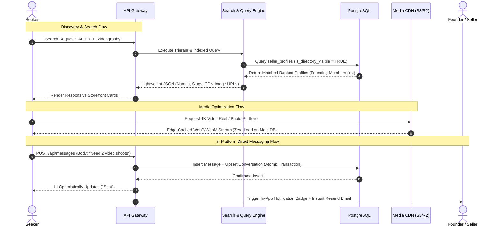
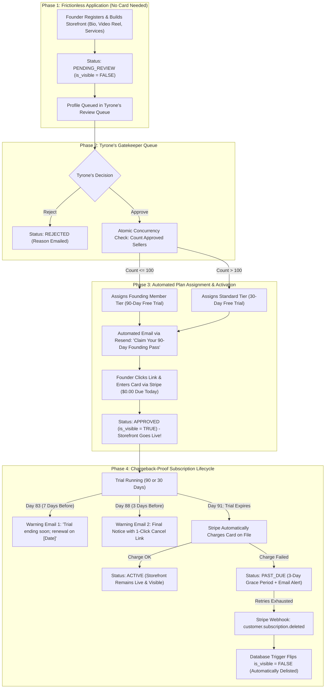

# Backend Architecture & Flowchart Specification (v2.0)
## Reverse-Engineering Contra.com & The Knot for a Production Marketplace
**Document Type:** System Architecture & Operational Flowcharts (.md)  
**Target:** Tyrone Strickland's Creator & Business Marketplace ($7,200 Scope)  
**Core Upgrades:** Deferred card onboarding, dual-stage chargeback defense, transactional email loop, and bot protection.

---

## 1. High-Level System Topology (The Hardened Architecture)

```mermaid
flowchart TD
    subgraph Clients["1. Client Layer"]
        C1["Seeker Browser (Desktop/Mobile Web)"]
        C2["Founder Storefront Dashboard"]
        C3["Admin Command Center (Tyrone)"]
    end

    subgraph Edge["2. Edge & Security Layer"]
        CDN["Cloudflare Edge Network / DNS / SSL"]
        BotShield["Cloudflare Turnstile (Silent Bot Protection on Chat)"]
    end

    subgraph AppServer["3. Application & API Engine"]
        Gateway["Next.js Route Handlers & Auth Gate"]
        SearchEngine["Directory Query & Trigram Search Engine"]
        BillingEngine["Stripe Webhook Event Processor"]
        MsgEngine["Direct Messaging & Notification Service"]
        MediaSigner["Presigned Upload URL Generator"]
        EmailWorker["Transactional Email Worker (Resend / Postmark)"]
        OGWorker["Dynamic OpenGraph Meta Card Generator"]
    end

    subgraph StorageLayer["4. Data & Object Persistence"]
        DB[("PostgreSQL Database (Transactional Truth)")]
        R2[("Cloudflare R2 / AWS S3 (Media Storage)")]
        StripeCloud["Stripe Billing & Subscriptions Cloud"]
    end

    C1 & C2 & C3 --> CDN
    CDN --> BotShield
    BotShield --> Gateway

    Gateway --> SearchEngine
    Gateway --> BillingEngine
    Gateway --> MsgEngine
    Gateway --> MediaSigner
    Gateway --> EmailWorker
    Gateway --> OGWorker

    SearchEngine --> DB
    MsgEngine --> DB
    BillingEngine --> DB
    BillingEngine <--> StripeCloud

    MediaSigner -.->|"Returns 5-Min Upload Token"| C2
    C2 ==="Direct Video/Photo Upload (Bypasses Node Server)"===> R2
    R2 -.->|"Cached Media Delivery via Edge"| C1
    EmailWorker -.->|"Sends Approval / Lead / Warning Emails"| C2
```

---

## 2. Reverse-Engineering Contra.com: The Visual & Discovery Engine

Contra solves the "portfolio lag" problem and makes creator search feel instant:



---

## 3. Reverse-Engineering The Knot: The Vetting & Chargeback-Proof Subscription Engine

Here is the complete operational loop integrating **Deferred Card Collection** and the **Dual-Stage Chargeback Defense**:



---

## 4. How the System Calculates Without Breaking (The 5 Fail-Safes)

| Fail-Safe Mechanism | The Risk It Solves | How the Architecture Handles It |
| :--- | :--- | :--- |
| **1. Concurrency Row Lock** | Two admins approving at the same second creating 101 founding members. | Executes an atomic `SELECT ... FOR UPDATE` lock in PostgreSQL so the founding member counter never exceeds 100. |
| **2. Direct-to-Storage Media** | 20 videographers uploading 500MB reels crashing server memory. | Application server issues 5-minute temporary signed upload tickets. Files upload directly from the browser to cloud storage. |
| **3. Reactive Visibility Trigger** | Unpaid or delinquent sellers continuing to get leads. | A database-level trigger automatically enforces `is_directory_visible = TRUE` *only* while subscriptions are active. If a card declines, they disappear from search instantly. |
| **4. Dual-Stage Renewal Notice** | Bank chargebacks on Day 91 from creators claiming surprise renewal. | Automated emails at Day 83 and Day 88 provide clear renewal dates and cancellation links, satisfying US FTC and credit card network guidelines. |
| **5. Turnstile Bot Shield** | Competitors or automated bots spamming seller inboxes with crypto ads. | Cloudflare Turnstile blocks bot requests on the inquiry endpoint without annoying puzzle captchas. |
