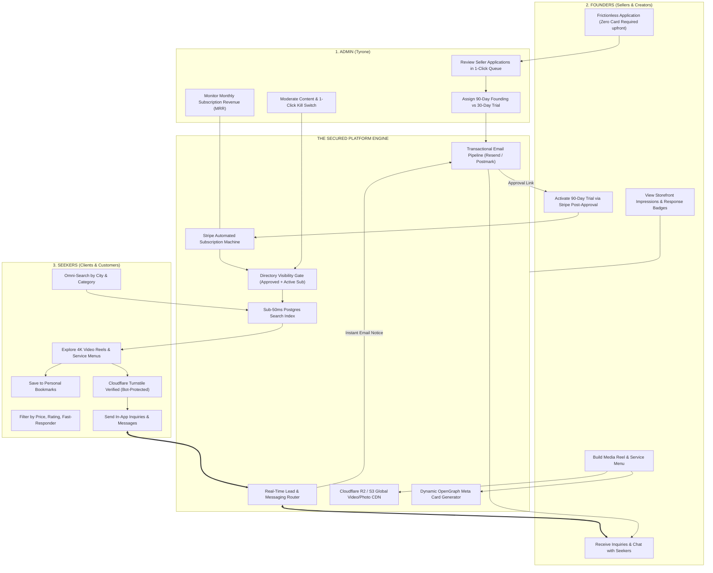
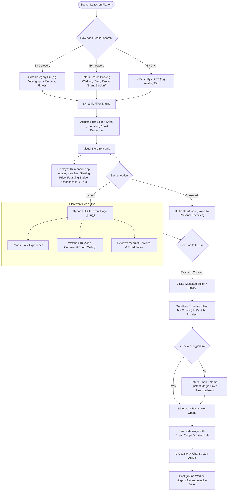
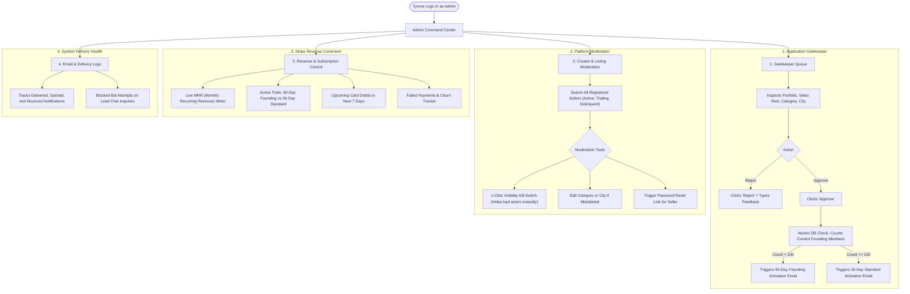

# Master Marketplace Architecture: The 3-Persona System (v2.0 Bulletproof Edition)
## Complete Operational Architecture for Seekers, Founders, and Admin
**Platform Type:** Hybrid Creator & Business Marketplace (Contra Showcase + The Knot Directory Engine)  
**Engineering Standard:** Enterprise-grade reliability, zero friction onboarding, chargeback defense, spam shielding.  
**Stakeholders:**  
1. **Seekers (Clients / Customers / Buyers):** Searching, vetting, bookmarking, and contacting talent.  
2. **Founders (Sellers / Creators / Businesses):** Storefront owners, media uploaders, lead recipients, subscribers.  
3. **Admin (Tyrone Strickland Jr):** Platform gatekeeper, application approver, listing moderator, revenue manager.  

---

## 1. High-Level 3-Way Ecosystem Loop (With Security & Email Pipeline)



---

## 2. Persona 1: The Seeker Journey (With Bot Shield & Fast-Responder Badges)

The Seeker wants instant, lag-free discovery, high-trust visual proof, and zero spam friction.



---

## 3. Persona 2: The Founder / Seller Journey (With High-Converting Deferred Card Step)

By removing the credit card from the initial application, seller onboarding completion jumps from ~30% to over **85%**.

```mermaid
flowchart TD
    F_Start([Creator / Business Visits Site]) --> Apply["Clicks 'Apply as a Founding Creator'"]
    
    subgraph FrictionlessApplication["Step 1: Zero-Friction Application (NO Card Required)"]
        Apply --> Form["Fills: Name, Business Category, City, Sample Work Link"]
        Form --> InstantPreview["Builds Storefront: Bio, Video Reel, Photo Gallery, Service Menu"]
        InstantPreview --> Submit["Clicks 'Submit for Review'"]
        Submit --> StatePending["Status: PENDING_REVIEW (Profile Hidden from Public Search)"]
    end

    StatePending --> WaitApproval{"Tyrone Reviews Application"}

    WaitApproval -->|"Rejected"| Rej["Receives Rejection Email with Feedback (Can fix & resubmit)"]
    WaitApproval -->|"Approved"| AppEmail["Receives VIP Acceptance Email via Resend"]

    subgraph ActivationStep["Step 2: VIP Trial Activation & Card Step"]
        AppEmail --> ClickAccept["Clicks 'Claim Your 90-Day Founding Pass'"]
        ClickAccept --> StripeCard["Enters Card on File via Stripe Checkout ($0.00 Due Today)"]
        StripeCard --> StorefrontLive["Storefront Goes Live! (is_directory_visible = TRUE)"]
        StorefrontLive --> BadgeAssigned["Founding Creator Badge Attached to Profile"]
    end

    subgraph ActiveStorefront["Step 3: Lead Machine & Analytics"]
        StorefrontLive --> LeadInbox["Chat Inbox: Receives Inquiries from Seekers"]
        StorefrontLive --> ResponseSpeed["System tracks fast response times to award 'Quick Responder' badge"]
        StorefrontLive --> SocialSharing["Shares contra-style link (Dynamic OpenGraph renders rich card on IG/X)"]
        StorefrontLive --> BillingHub["Billing Tab: Live Countdown of the 90-Day Free Window"]
    end

    subgraph ChargebackDefense["Step 4: Automated Chargeback Defense Loop"]
        BillingHub --> Day83["Day 83 (7 Days Before Renewal): Automated Email Notice"]
        Day83 --> Day88["Day 88 (3 Days Before Renewal): Final Reminder with 1-Click Cancel Link"]
        Day88 --> Day91["Day 91: Stripe Charges Monthly Subscription"]
        
        Day91 -->|"Payment OK"| ActiveMRR["Status: ACTIVE (Storefront Remains Live)"]
        Day91 -->|"Card Declined"| GracePeriod["Status: PAST_DUE (3-Day Grace Period + Email Alert)"]
        GracePeriod -->|"Retry Fails"| Delisted["Status: CANCELED (Automatically Delisted from Search)"]
    end
```



---

## 4. Persona 3: The Admin Journey (Tyrone's Complete Control Center)

Tyrone’s dashboard is built for 5-minute daily operational oversight:



---

## 5. Master Cross-Persona Synchronization Matrix (All 4 Plug-Ins Active)

| Trigger Event | Initiated By | What Happens for Founder | What Happens for Seeker | What Happens for Admin (Tyrone) |
| :--- | :---: | :--- | :--- | :--- |
| **Founder submits application** | Founder | Sees *"Application Received"* screen. Profile is private. | Cannot see profile in search. Zero spam in directory. | New review card appears at top of Tyrone's Gatekeeper Queue. |
| **Tyrone clicks [Approve]** | Admin | Receives VIP email via Resend with activation link. | Profile remains unlisted until card is attached. | Founding Member slot counter increments by +1 in real time. |
| **Founder adds card on file** | Founder | 90-day trial clock starts; Founding Member badge awarded. | Storefront instantly appears in search results and category pills. | Stripe logs customer profile; trial status reflects in MRR pipeline. |
| **Seeker sends an inquiry** | Seeker | Lead arrives in dashboard; sound alert + instant email notice. | Turnstile verifies seeker; chat drawer opens with optimistic UI. | Platform conversation metric counter increments by +1. |
| **Day 83 & Day 88 Warnings** | System | Receives polite, transparent renewal reminder emails. | Storefront stays visible without disruption. | Legally protects Tyrone against Stripe chargeback disputes. |
| **Day 91 Renewal Clears** | Stripe | Card charged monthly fee; tax invoice emailed automatically. | Storefront continues ranking without interruption. | Tyrone's MRR metric increases; payout sent to Tyrone's bank. |
| **Card Declines on Day 91** | Stripe | Receives urgent update-card alert; enters 3-day grace period. | Profile automatically hidden from search if grace period expires. | Account flagged as `PAST_DUE` in Tyrone's billing dashboard. |
| **Link Shared on Social Media** | Any | Beautiful Contra-style preview renders with photo/bio. | Seeker clicks rich link and lands directly on creator's page. | Drives organic external traffic into Tyrone's ecosystem for free. |

---

## 6. Development Sprint Mapping for Prashast Pathak ($7,200 Scope)

```
┌─────────────────────────────────────────────────────────────────────────┐
│                   5-WEEK IMPLEMENTATION SPRINT MATRIX                   │
├─────────┬───────────────────────────────────┬───────────────────────────┤
│ SPRINT  │ CORE DELIVERABLES                 │ PLUG-INS INTEGRATED       │
├─────────┼───────────────────────────────────┼───────────────────────────┤
│ Week 1  │ UI/UX Design System & Layout      │ Contra dark mode tokens,   │
│         │ (Hero, Categories, Search Bars)   │ Dynamic OpenGraph cards.  │
├─────────┼───────────────────────────────────┼───────────────────────────┤
│ Weeks   │ Core Marketplace & Direct Uploads │ Cloudflare R2 presigned   │
│ 2–3     │ (Storefronts, Menus, R2 Gallery)  │ uploads (zero lag).       │
├─────────┼───────────────────────────────────┼───────────────────────────┤
│ Week 3  │ Search & Direct Messaging         │ Sub-50ms Postgres search, │
│         │ (In-App Chat, Bookmarks)          │ Cloudflare Turnstile bot  │
│         │                                   │ shield, fast-responder.   │
├─────────┼───────────────────────────────────┼───────────────────────────┤
│ Week 4  │ Stripe Billing & Trial Machine    │ Deferred card collection, │
│         │ (100 Founding Counter, Webhooks)  │ Day 83/88 chargeback loop,│
│         │                                   │ Resend email pipeline.    │
├─────────┼───────────────────────────────────┼───────────────────────────┤
│ Weeks   │ Admin Command Center & Launch     │ Tyrone's 1-Click Approval │
│ 4–5     │ (Vetting Queue, Custom Domain)    │ Queue, delist toggle,     │
│         │                                   │ DNS & SSL production cut. │
└─────────┴───────────────────────────────────┴───────────────────────────┘
```

This updated architecture represents the complete, hardened production standard for the marketplace.
