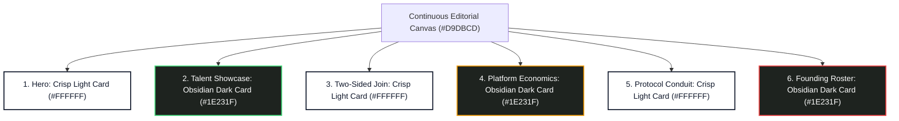

# Full Reference Card Enclosure Implementation Plan

Synthesizing the reference video (`From Klickpin.com- ...mp4`), the reverse-engineering specification ([Reverse-Engineering Plan for Tyrone's Marketplace.pdf](file:///Users/prashastpathak/Downloads/Reverse-Engineering%20Plan%20for%20Tyrone's%20Marketplace.pdf)), and our codebase on [index.html](file:///Users/prashastpathak/Downloads/marketplace-architecture/index.html).

---

## 1. Executive Summary & Design Contract

In the reference video (*BrainwaveBoard*), the webpage does not use generic full-bleed colored strips. Instead, **every single section lives inside a dedicated, centered squircle card** with 32px corner radii, floating over a continuous warm editorial canvas (`#D9DBCD`).

The sections alternate rhythmically between **Crisp Light Cards** and **Obsidian Dark Cards**:

---

## 2. Section-by-Section Visual Architecture

### A. Global Shell & Navigation
- **Body Canvas**: Background color `#D9DBCD` with subtle ambient texture.
- **Top Sticky Nav**: Pinned floating capsule at `top: 18px`, centered with `border-radius: 999px`, glassy backdrop (`rgba(255, 255, 255, 0.88)` / `backdrop-filter: blur(18px)`), brand on left, active section pill indicator in the center, and CTA button (`Apply ->`) on the right.

### B. Card 1: Hero Viewport (`#hero`) — *Crisp Light Card*
- **Card Styling**: `background: #FFFFFF; border-radius: 32px; max-width: 1280px; margin: 24px auto; box-shadow: 0 24px 64px -12px rgba(15, 23, 42, 0.08);`
- **Content**:
  - High-impact headline stack (`WE FIND THE CREATIVE EDGE`).
  - Subheadline and dual action buttons (`Discover Talent ->` | `Join as Creator`).
  - Character illustration stage with 5 selectable theme presets (`Sage`, `Cobalt`, `Lilac`, `Amber`, `Coral`).
- **Motion**: Initial Anime.js v4 entrance cascades title stack, kicker, and buttons (`translateY: [36, 0]`, `duration: 650ms`).

### C. Card 2: Talent Showcase (`#showcase`) — *Obsidian Dark Card*
- **Card Styling**: `background: #181C19; color: #FFFFFF; border-radius: 32px; max-width: 1280px; margin: 32px auto; box-shadow: 0 32px 72px -16px rgba(0, 0, 0, 0.25);`
- **Content**:
  - Section header: Pill tag (`01 / TALENT ROSTER`), title (`CURATED DIRECTORY`), subtitle.
  - Interactive cinema reel with 36 vetted creator works, craft filters (`All`, `Film`, `Aerial`, `3D`, `Direction`), and hover autoplay previews.
- **Motion**: On scroll arrival, the dark card and inner reel elevate into place (`translateY: [40, 0]`, `opacity: [0.7, 1]`).

### D. Card 3: Two-Sided Join (`#join`) — *Crisp Light Card*
- **Card Styling**: `background: #FFFFFF; color: #0F172A; border-radius: 32px; max-width: 1280px; margin: 32px auto; box-shadow: 0 24px 64px -12px rgba(15, 23, 42, 0.08);`
- **Content**:
  - Centered dual pill selector (`For clients` | `For creators` | `Log in`).
  - Client side: Instant brief submission form (craft, need, city, email). Connected to `POST /api/waitlist`.
  - Creator side: Founding 100 membership benefits ($49/mo flat, 0% commission, 90-day free trial).
- **Centering Lock**: `.jn-tabs` locked at `719.99px` (exact center of a 1440px viewport) using native CSS flexbox with `transform: none`.

### E. Card 4: Platform Economics (`#fees`) — *Obsidian Dark Card*
- **Card Styling**: `background: #181C19; color: #FFFFFF; border-radius: 32px; max-width: 1280px; margin: 32px auto; box-shadow: 0 32px 72px -16px rgba(0, 0, 0, 0.25);`
- **Content**:
  - Comparison between 25% agency/platform cut vs 0% Nexus Direct.
  - Interactive budget scrubber pills: `$15k`, `$50k`, `$120k`, `$250k`.
  - Rolling number odometers (`.nx-count`: `20%`, `0%`, `$19.99`, `100%`, `25%`, `35%`).
- **Motion**: Odometers count up smoothly upon arrival using Anime.js numerical interpolation (`1250ms`, `out(1.675)`).

### F. Card 5: Process Pipeline (`#how`) — *Crisp Light Card*
- **Card Styling**: `background: #FFFFFF; color: #0F172A; border-radius: 32px; max-width: 1280px; margin: 32px auto; box-shadow: 0 24px 64px -12px rgba(15, 23, 42, 0.08);`
- **Content**:
  - 4-step pipeline: Browse & Match -> Direct Dispatch -> Direct Settlement -> Verified Trust.
  - Interactive conduit illumination tracks and automated real-life dispatch scenario runner.
- **Motion**: Staggered card lift (`delay: anime.stagger(50ms)`).

### G. Card 6: Founding Roster CTA (`#founding`) — *Obsidian Dark Card*
- **Card Styling**: `background: #181C19; color: #FFFFFF; border-radius: 32px; max-width: 1280px; margin: 32px auto; box-shadow: 0 32px 72px -16px rgba(0, 0, 0, 0.25);`
- **Content**:
  - High-impact Founding 100 countdown banner, interactive 3D flip pass, and 1-click application trigger.
- **Motion**: Smooth card elevation and glowing pass rotation.

---

## 3. Implementation Steps & Task Breakdown

1. **Step 1: CSS Architecture for Squircle Card Containers**:
   - In `css/base.css`, set `body` background to `#D9DBCD`.
   - Add `.nx-section-card` container class with `max-width: 1280px; margin: 36px auto; border-radius: 32px; overflow: hidden;`.
   - Update `css/hero.css`, `css/showcase.css`, `css/join.css`, `css/fees.css`, `css/how.css`, and `css/founding.css` to wrap each section's contents in the alternating Light/Dark squircle card layout.

2. **Step 2: Update HTML Structure in `index.html` and `index-v2.html`**:
   - Apply the `.nx-section-card` wrapper to each section:
     - `#hero`: `.nx-card-light`
     - `#showcase`: `.nx-card-dark`
     - `#join`: `.nx-card-light`
     - `#fees`: `.nx-card-dark`
     - `#how`: `.nx-card-light`
     - `#founding`: `.nx-card-dark`

3. **Step 3: Anime.js v4 Card Elevation & Rolling Odometers**:
   - In `js/theme-engine.js`, configure `animateSectionStart` to elevate the `.nx-section-card` and its child elements (`translateY: [36, 0]`, `opacity: [0.75, 1]`, duration: 620ms, ease: `'out(1.675)'`).
   - In `js/scroll-choreography.js`, ensure `.nx-count` rolling odometers count up cleanly upon card arrival.

4. **Step 4: Continuous Scroll & Centering Verification**:
   - Guarantee sections never disappear when scrolled past (100% solid on scroll-up).
   - Verify `.jn-tabs` is strictly centered at `719.99px` with `transform: none`.

5. **Step 5: Automated Playwright Verification**:
   - Run end-to-end test suite testing desktop (1440x900) and mobile (390x844), checking 0 console errors, tab centering, card elevations, and rolling odometers.
